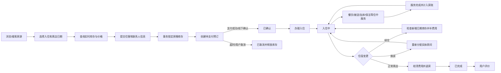
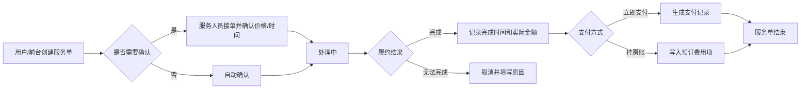
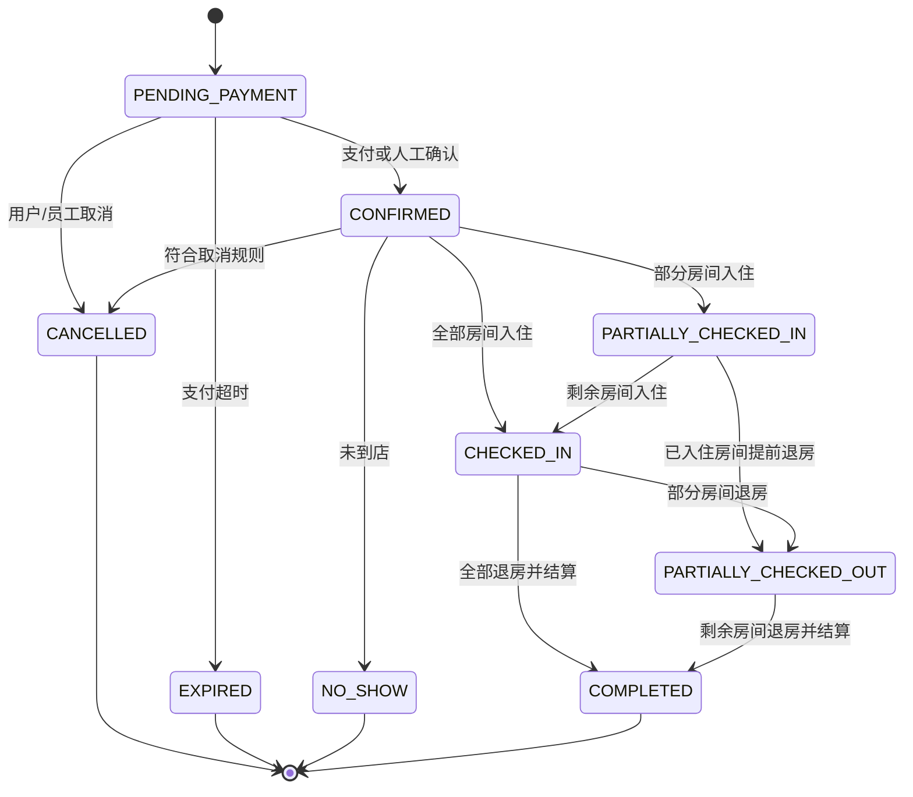
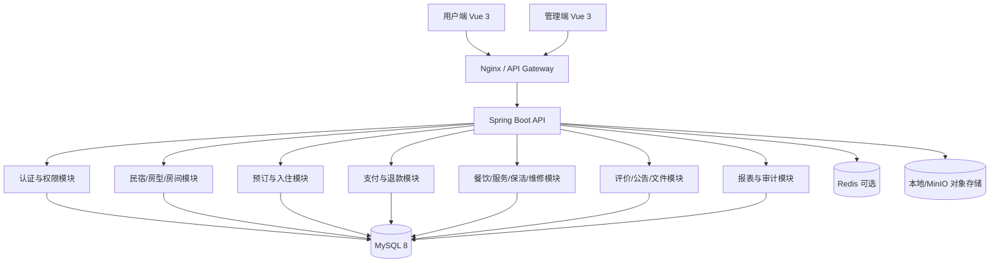

# 民宿服务信息管理系统详细开发文档

> 文档版本：1.2  
> 文档状态：开发基线  
> 适用范围：重新设计并开发一套包含用户端、运营管理端和后端服务的民宿预订管理系统  
> 参考项目：`homestayHotelPublic` 的房源、预订、入住、续住、退房、评价和统计业务  
> 推荐技术栈：Java 21、Spring Boot 3.x、MyBatis-Plus、Sa-Token、MySQL 8、Vue 3、TypeScript、Vite、Element Plus

---

## 版本记录

| 版本 | 变更 |
|---|---|
| 1.0 | 完成房源、库存、预订、支付、入住退房、评价、权限、数据库和 API 基线 |
| 1.1 | 补充价格促销、收藏消息、住客档案、餐饮与菜品定制、住中服务、房账、保洁维修、售后通知及异常场景 |
| 1.2 | 明确模拟微信扫码支付、一单多房、押金/分段取消规则及身份证加密保存方案 |

---

## 1. 文档目的

本文档用于统一产品、设计、前端、后端、测试和部署人员对系统的理解，作为需求评审、数据库设计、接口开发、测试验收及上线部署的共同依据。

本文不是对参考项目的原样复刻。新系统保留其主要业务，但对以下问题重新设计：

1. 将“民宿、房型、实体房间”拆分，避免全部信息堆在一张房间表中。
2. 使用按入住日期计算的库存，不使用单一的“空闲/预订/入住”字段判断未来房态。
3. 统一用户身份体系，避免前台用户和后台用户账号、令牌相互冲突。
4. 分离预订状态、支付状态和实体房间运营状态。
5. 使用事务和唯一约束防止同一房间在相同日期被重复预订。
6. 价格、住客信息、房间信息在下单时保存快照，防止后续修改基础资料影响历史订单。
7. 用户端与管理端独立构建，后端按业务模块组织，不照搬若依的大而全结构。

---

## 2. 项目目标

### 2.1 业务目标

- 为游客提供房源浏览、空房查询、在线预订、订单管理和入住后评价服务。
- 为前台员工提供预订处理、入住、续住、换房、退房及收款能力。
- 为管理员提供民宿、房型、房间、用户、员工、权限、评价、公告和经营数据管理能力。
- 形成“内容种草 → 查询房源 → 锁定库存 → 创建预订 → 支付确认 → 入住 → 住中服务/餐饮消费 → 退房结算 → 评价售后”的完整闭环。
- 将住宿之外的餐饮、接送、保洁、加床和个性化需求纳入统一服务订单与房账管理。

### 2.2 技术目标

- 前后端分离，API 使用 REST 风格并提供 OpenAPI 文档。
- 支持 PC 与移动浏览器，用户端优先适配手机屏幕。
- 核心写操作具备事务、幂等和并发保护。
- 数据库结构可迁移、可初始化、可追踪版本。
- 不在代码仓库中保存数据库密码、JWT 密钥和对象存储密钥。
- 核心业务具备单元测试、集成测试和端到端测试。

### 2.3 首期不做

以下功能不纳入 MVP，但预留扩展接口：

- 对接携程、飞猪、Airbnb 等 OTA 渠道。
- 真实银行卡、微信或支付宝支付清结算。
- 发票、公安旅业登记、门锁和身份证读卡器对接。
- 多商户入驻、平台抽佣及复杂多租户结算。
- 动态定价算法、会员积分和优惠券中心。
- 原生 Android、iOS App 和微信小程序。

---

## 3. 项目范围和版本规划

### 3.1 MVP 必做范围

- 用户注册、登录、退出、刷新令牌、忘记密码。
- 首页推荐、民宿和房型浏览、条件搜索、日期库存查询。
- 房型详情、图片、设施、价格和用户评价展示。
- 创建一单多房预订、模拟微信扫码支付/线下收款、取消预订、查看订单。
- 管理端预订查询、人工新增预订、确认、入住、续住、退房。
- 民宿、房型、实体房间、图片和设施管理。
- 用户、员工、角色和权限管理。
- 评价发布、展示、隐藏和回复。
- 公告发布与用户端展示。
- 收藏、浏览历史、站内通知和常用入住人。
- 房价日历、临时调价、维修封房和房态日历。
- 入住期间的餐饮点单、菜品定制、加床、接送和保洁服务申请。
- 服务订单处理、挂房账和退房统一结算。
- 保洁任务、维修工单和用户投诉/售后处理。
- 基础经营看板和审计日志。

### 3.2 第二阶段

- 部分退款、复杂渠道退款和押金批量原路退回。
- 拆分/合并账单和大型团队入住。
- 短信、邮件和微信公众号通知。
- Excel 导入导出和财务对账。
- 优惠券、套餐、会员等级和积分。

### 3.3 第三阶段

- 多门店经营分析。
- 电子发票、OTA、门锁等外部系统；真实支付不在本项目路线内。
- 智能客服、动态定价和个性化房源/美食推荐。

### 3.4 业务优先级

| 优先级 | 业务模块 | 交付要求 |
|---|---|---|
| P0 | 账号、房源、库存、试价、预订、支付、入住、退房、权限 | 缺少任一模块都不能形成住宿业务闭环 |
| P0 | 一单多房、模拟微信扫码支付、押金、分段取消、身份证加密保存 | 已确认的首期产品基线 |
| P0 | 房账、住中服务、餐饮定制、保洁联动 | 本次完整版业务必须贯通订单和结算 |
| P1 | 续住、换房、退款、维修、售后、通知、评价、公告 | 首次正式上线前完成 |
| P1 | 房价日历、促销、收藏、住客档案和综合报表 | 支撑日常运营与转化 |
| P2 | 会员、优惠券、第三方通知和财务导出 | 核心稳定后迭代 |
| P3 | OTA、发票、门锁、智能推荐、多租户 | 独立项目评估和建设；真实支付明确不做 |

### 3.5 已确认的产品基线

1. 支付只做模拟，不接入微信商户平台，不发生真实资金交易。
2. 用户端以“模拟微信扫码支付”方式展示二维码和扫码确认页，同时保留管理端线下收款。
3. 一个订单允许包含多个房型和多间房，订单内各房间可以分配不同入住人。
4. 押金必须支持固定金额、按房间收取和按订单比例收取，并在退房查房后退还或扣除。
5. 取消规则必须支持按距离入住时间分段收费，规则在下单时保存快照。
6. 保存实际入住人的身份证信息；完整号码加密保存，日常接口只返回脱敏值。
7. 以上能力均为 P0，不作为“后续可选功能”。

---

## 4. 角色与权限

### 4.1 系统角色

| 角色 | 标识 | 主要职责 |
|---|---|---|
| 游客 | `GUEST` | 浏览、搜索、查看详情和公告，不能创建预订 |
| 注册用户 | `CUSTOMER` | 维护本人资料、预订、支付、取消、查看订单和评价 |
| 前台员工 | `RECEPTIONIST` | 人工预订、收款、入住、续住、换房和退房 |
| 服务人员 | `SERVICE_STAFF` | 接收餐饮、接送、加床等住中服务订单并执行 |
| 保洁人员 | `HOUSEKEEPER` | 接收保洁任务、更新清扫进度和房间洁净状态 |
| 财务人员 | `FINANCE` | 收退款复核、对账、收入报表和财务导出 |
| 运营管理员 | `MANAGER` | 管理房源、房价、评价、公告、用户和经营报表 |
| 超级管理员 | `SUPER_ADMIN` | 员工、角色、权限、系统参数、审计日志等全部权限 |

### 4.2 权限模型

采用 RBAC：用户关联角色，角色关联权限。权限以字符串编码控制，例如：

- `property:list`、`property:create`、`property:update`
- `room:list`、`room:create`、`room:status:update`
- `reservation:list`、`reservation:create`
- `reservation:checkin`、`reservation:extend`、`reservation:checkout`
- `payment:collect`、`payment:refund`
- `deposit:collect`、`deposit:settle`、`deposit:waive`
- `reservation:cancel`、`reservation:cancel:override`
- `guest:id-card:view-full`
- `service-order:list`、`service-order:accept`、`service-order:complete`
- `housekeeping:assign`、`housekeeping:update`
- `maintenance:create`、`maintenance:close`
- `review:moderate`
- `report:view`
- `system:user:manage`、`system:role:manage`

前端菜单只负责展示控制，后端接口必须再次校验权限。菜单路由建议在前端静态声明，根据权限码过滤，不建议把任意组件路径完全交给数据库动态控制。

### 4.3 权限矩阵

| 功能 | 游客 | 注册用户 | 前台员工 | 运营管理员 | 超级管理员 |
|---|:---:|:---:|:---:|:---:|:---:|
| 浏览和查询房源 | ✓ | ✓ | ✓ | ✓ | ✓ |
| 创建本人预订 |  | ✓ | ✓ | ✓ | ✓ |
| 查看本人订单 |  | ✓ |  |  |  |
| 查看全部预订 |  |  | ✓ | ✓ | ✓ |
| 入住、续住、退房 |  |  | ✓ | ✓ | ✓ |
| 收款 |  | 可模拟在线支付 | ✓ | ✓ | ✓ |
| 管理民宿、房型、房间 |  |  | 只读 | ✓ | ✓ |
| 发布评价 |  | ✓ |  |  |  |
| 审核评价和公告 |  |  |  | ✓ | ✓ |
| 用户和员工管理 |  |  |  | 部分 | ✓ |
| 角色和权限管理 |  |  |  |  | ✓ |
| 查看审计日志 |  |  |  | 只读 | ✓ |

服务人员、保洁人员和财务人员采用最小权限：服务人员只处理分配给本岗位的服务单，保洁人员只处理房务任务，财务人员可以查看支付与退款但不能修改房源或角色权限。运营管理员负责跨岗位调度，超级管理员负责系统权限。

---

## 5. 核心业务术语

| 术语 | 定义 |
|---|---|
| 民宿/门店 `Property` | 可独立经营和展示的住宿场所，包含名称、地址、介绍和联系方式 |
| 房型 `RoomType` | 对外售卖的产品，如“大床房”“湖景家庭房”，保存面积、床型、人数和基础价格 |
| 实体房间 `Room` | 实际可入住的房间，如 301、302，用于房态和入住分配 |
| 可售库存 | 某入住日期范围内可分配且未被预订、维修或人工封锁的实体房间 |
| 预订 `Reservation` | 用户或员工创建的住宿业务单据 |
| 房晚 | 一个实体房间住宿一晚。入住日计入，离店日不计入 |
| 入住人 `Guest` | 实际入住者，可以与下单账号不是同一人 |
| 费用项 `Charge` | 房费、加床、餐饮、押金调整或其他服务形成的金额明细 |
| 支付 `Payment` | 针对预订发生的一次收款记录 |
| 退款 `Refund` | 针对已成功支付记录发生的一次退回记录 |
| 房账 `Folio` | 某次入住期间应收、已收、退款和未结费用的汇总账页 |
| 服务项目 `ServiceItem` | 接送、加床、保洁、延迟退房等可预约或购买的服务 |
| 服务订单 `ServiceOrder` | 用户或员工针对住中服务发起的履约单，可挂入房账 |
| 菜品 `MenuItem` | 民宿提供的早餐、正餐、饮品或当地特色餐食 |
| 餐饮订单 `DiningOrder` | 包含送餐时间、地点、口味和忌口要求的餐饮履约单 |
| 保洁任务 `HousekeepingTask` | 退房清扫、住中清洁、查房或布草补充任务 |
| 维修工单 `MaintenanceTicket` | 房间或设施故障的报告、派工、处理和验收记录 |
| 售后工单 `SupportTicket` | 用户咨询、投诉、遗失物品或退款争议的处理记录 |
| 通知 `Notification` | 面向用户或员工的站内消息，以及可选短信/邮件发送记录 |

---

## 6. 总体业务流程



### 6.1 完整客户旅程

| 阶段 | 用户触点 | 系统能力 | 运营动作 |
|---|---|---|---|
| 预订前 | 首页、攻略、公告、收藏、搜索 | 内容推荐、可售查询、价格试算 | 维护房源、价格、图片、设施和公告 |
| 下单 | 订单确认、联系人、入住人 | 库存锁定、价格快照、风控校验 | 处理特殊要求和人工预订 |
| 支付后 | 订单详情、到店指引、通知 | 支付入账、入住提醒、取消退款 | 确认订单、预分房、准备房间 |
| 到店 | 入住确认、押金、身份信息 | 分房、入住登记、房态切换 | 查验证件、收押金、发放入住信息 |
| 入住中 | 餐饮、菜品定制、接送、加床、清洁 | 服务下单、派单、进度、挂房账 | 接单、履约、异常处理 |
| 离店 | 账单确认、付款、退房 | 房账汇总、补收/退款、退房 | 查房、结算、生成保洁任务 |
| 离店后 | 评价、投诉、遗失物品 | 评价、售后工单、消息通知 | 回复评价、处理投诉和失物 |

### 6.2 住中服务履约流程



---

## 7. 状态模型

### 7.1 预订状态

| 状态 | 编码 | 说明 | 允许的后续状态 |
|---|---|---|---|
| 待支付 | `PENDING_PAYMENT` | 已临时锁定库存，等待付款 | `CONFIRMED`、`CANCELLED`、`EXPIRED` |
| 已确认 | `CONFIRMED` | 已支付或由员工确认 | `PARTIALLY_CHECKED_IN`、`CHECKED_IN`、`CANCELLED`、`NO_SHOW` |
| 部分入住 | `PARTIALLY_CHECKED_IN` | 多房订单已有部分房间入住 | `CHECKED_IN`、`PARTIALLY_CHECKED_OUT` |
| 已全部入住 | `CHECKED_IN` | 订单内应入住房间已全部办理入住 | `PARTIALLY_CHECKED_OUT`、`COMPLETED` |
| 部分退房 | `PARTIALLY_CHECKED_OUT` | 多房订单已有部分房间退房 | `COMPLETED` |
| 已完成 | `COMPLETED` | 已退房且账务结清 | 终态 |
| 已取消 | `CANCELLED` | 用户或员工主动取消 | 终态 |
| 已过期 | `EXPIRED` | 待支付超时自动关闭 | 终态 |
| 未到店 | `NO_SHOW` | 超过入住规则仍未到店 | 终态 |

一单多房时，订单头状态反映整体进度；每个 `reservation_item/reservation_room` 另有 `RESERVED/ASSIGNED/CHECKED_IN/CHECKED_OUT/CANCELLED/NO_SHOW` 状态。部分房间取消或未到店不会错误地把整张订单直接置为取消。

禁止使用“删除”作为业务状态。业务订单默认不物理删除；确需隐藏时使用归档标记。



### 7.2 支付状态

| 状态 | 编码 | 说明 |
|---|---|---|
| 未支付 | `UNPAID` | 没有成功收款 |
| 部分支付 | `PARTIALLY_PAID` | 已收金额小于应收金额 |
| 已支付 | `PAID` | 已收金额等于或大于当前应收金额 |
| 部分退款 | `PARTIALLY_REFUNDED` | 已发生部分退款 |
| 已退款 | `REFUNDED` | 可退金额已全部退回 |

支付状态根据有效支付和退款记录计算，不允许前端直接修改。

### 7.3 实体房间运营状态

| 状态 | 编码 | 说明 |
|---|---|---|
| 可用 | `AVAILABLE` | 可正常分配 |
| 入住中 | `OCCUPIED` | 当前有住客入住 |
| 待清洁 | `DIRTY` | 退房后等待保洁 |
| 清洁中 | `CLEANING` | 正在保洁 |
| 维修中 | `MAINTENANCE` | 不允许分配 |
| 停用 | `DISABLED` | 长期下架 |

“未来已被预订”属于日期库存，不属于实体房间当前运营状态。

### 7.4 服务订单状态

| 状态 | 编码 | 说明 |
|---|---|---|
| 待确认 | `PENDING_CONFIRMATION` | 等待服务岗位确认时间或价格 |
| 已确认 | `CONFIRMED` | 已接受，等待开始 |
| 处理中 | `IN_PROGRESS` | 正在制作、配送或执行 |
| 已完成 | `COMPLETED` | 已履约并确认实际金额 |
| 已取消 | `CANCELLED` | 用户或员工取消 |
| 已拒绝 | `REJECTED` | 因库存、时间或服务范围无法履约 |

状态只能按 `PENDING_CONFIRMATION → CONFIRMED → IN_PROGRESS → COMPLETED` 正向推进；取消和拒绝必须记录原因。完成前允许调整实际数量，完成后金额变更需要财务权限并产生审计记录。

### 7.5 餐饮订单状态

餐饮订单使用 `PENDING_CONFIRMATION/CONFIRMED/PREPARING/READY/DELIVERING/COMPLETED/CANCELLED/REJECTED`。进入 `PREPARING` 后是否允许取消由菜品规则决定；口味、忌口和过敏原要求必须完整传递到制作端。

### 7.6 保洁任务状态

保洁任务使用 `PENDING/ASSIGNED/IN_PROGRESS/INSPECTION/PASSED/REWORK/CANCELLED`。退房完成后自动创建退房清扫任务；验收通过后实体房间才能从 `DIRTY` 转为 `AVAILABLE`。

### 7.7 维修工单状态

维修工单使用 `OPEN/ASSIGNED/IN_PROGRESS/WAITING_PARTS/RESOLVED/VERIFIED/CLOSED/CANCELLED`。涉及安全或核心设施故障时自动封房；维修验收通过后才能解除相应日期的库存封锁。

### 7.8 售后工单状态

售后工单使用 `OPEN/PROCESSING/WAITING_CUSTOMER/RESOLVED/CLOSED`，并记录优先级、责任岗位、首次响应时间、解决时间和用户满意度。

---

## 8. 详细功能需求

### 8.1 用户端

#### 8.1.1 首页

- 展示轮播图、推荐民宿、热门房型、城市入口和最新公告。
- 推荐排序由管理员权重、有效评分和近期订单量综合计算。
- 不允许简单累加历史评分作为永久权重。
- 未登录用户可以浏览；预订、收藏等操作要求登录。

#### 8.1.2 房源搜索

搜索条件：

- 城市或关键词。
- 入住日期、离店日期。
- 入住人数、房间数量。
- 价格区间。
- 房型、床型、设施。
- 排序：推荐、价格升序、价格降序、评分、销量。

搜索结果必须只返回日期区间内库存充足的房型，并返回含税总价或明确的价格说明。

#### 8.1.3 民宿与房型详情

- 民宿名称、地址、地图坐标、联系电话、营业时间和介绍。
- 房型名称、面积、床型、最大入住人数、设施、图片和取消规则。
- 日期价格和可售数量。
- 平均评分、评分分布和脱敏后的评价列表。
- 同一民宿的其他可售房型推荐。

#### 8.1.4 注册与登录

- 用户名或手机号注册。
- 用户名、手机号必须唯一。
- 密码长度不少于 8 位，密码只保存哈希。
- 登录失败次数需要限制，连续失败后短暂冻结或触发验证码。
- 忘记密码通过验证码或管理员协助重置，禁止直接返回新密码。
- 支持访问令牌和刷新令牌；退出后刷新令牌失效。

#### 8.1.5 创建预订

用户填写：

- 统一的入住、离店日期。
- 一个或多个房型，每个房型的房间数量和入住人数。
- 联系人姓名、手机号。
- 每间房的主要入住人及同行人分配；下单时可以先填主要联系人，其余住客最迟在入住前补全。
- 特殊要求和备注。

系统处理：

1. 服务端逐个订单明细校验日期、人数、上下架状态和实时库存。
2. 服务端按“房型 × 房间数 × 每个房晚”重新计算价格，不能信任前端金额。
3. 在同一个数据库事务内为全部明细锁定房晚库存并创建预订；任一明细库存不足则整单失败，不产生半张订单。
4. 生成不可预测的业务订单号。
5. 返回支付信息和库存保留截止时间。

首期一张订单内所有房间使用相同入住和离店日期，但允许多个房型。后续如需不同日期，应拆分为不同订单，避免部分改期和结算规则过度复杂。

#### 8.1.6 支付

MVP 明确只支持以下方式：

- 用户端模拟微信扫码支付。
- 管理端登记现金、银行卡或转账等线下收款。

模拟微信扫码支付流程：

1. 用户在订单支付页点击“微信扫码支付（模拟）”。
2. 后端创建状态为 `PENDING` 的模拟支付单和一次性扫码会话。
3. 页面展示二维码，二维码内容指向系统自己的 `/mock-pay/wechat/{token}` 页面。
4. 用户使用手机扫码后看到订单号、金额和“确认模拟支付”按钮。
5. 用户确认后，后端校验一次性令牌、支付单状态、金额和有效期。
6. 支付单更新为 `SUCCEEDED`，订单重新计算支付状态；达到确认条件后转为 `CONFIRMED`。
7. PC 支付页轮询或通过 SSE 获取结果并跳转支付成功页。

模拟页必须清楚显示“模拟支付，不会产生真实扣款”，不得请求真实微信账号、支付密码或银行卡信息。二维码默认 5 分钟失效；失效后可以重新生成，但不得重复入账。

测试环境提供成功、失败、用户取消、超时四种模拟结果。创建支付单必须携带幂等键；重复确认只返回原结果。

#### 8.1.7 我的订单

- 按全部、待支付、已确认、入住中、已完成、已取消筛选。
- 查看订单详情、住客、费用和支付记录。
- 按房型和实体房展示多房明细、入住人分配及各房间状态。
- 待支付订单可以继续支付。
- 符合规则的订单可以整单取消或取消指定未入住房间，并在确认前展示取消费和模拟退款金额。
- 已完成且未评价订单可以提交一次评价。
- 用户只能访问本人订单。

#### 8.1.8 个人中心

- 查看和修改头像、昵称、真实姓名、性别、手机号和邮箱。
- 修改密码。
- 管理常用入住人。
- 保存常用入住人的身份证件类型和号码；提交后只显示脱敏值，不回显完整号码。
- 修改证件号码时按“重新录入”处理，不能从接口读取原始明文后编辑。
- 查看登录设备或最近登录记录。
- 注销账号；存在未完成订单时不允许直接注销。

#### 8.1.9 收藏与浏览历史

- 登录用户可以收藏/取消收藏民宿或房型。
- 收藏列表实时展示当前价格与可售状态，但不保证未来日期库存。
- 记录最近浏览的民宿和房型，用户可以一键清空。
- 收藏和浏览数据可以用于推荐，但首期只做规则排序，不做复杂算法。

#### 8.1.10 行前服务与消息

- 已确认订单展示地址、交通指引、入住时间、联系电话和入住须知。
- 入住前按配置时间发送站内提醒；短信/邮件作为可选通道。
- 用户可以查看支付成功、订单确认、入住提醒、服务单进度、退款和售后消息。
- 消息具有未读数、已读时间和业务跳转链接。

#### 8.1.11 住中服务

仅已确认且临近入住、或入住中的订单可以购买相应服务：

- 接送站/接送机。
- 加床、婴儿床、早餐加购。
- 住中保洁、布草和洗漱用品补充。
- 延迟退房申请。
- 行李寄存、叫醒和其他人工服务。

用户选择期望服务时间、数量、联系人和备注。系统展示预计价格和服务状态；服务人员可以确认、拒绝、开始和完成。完成后的费用支持立即支付或挂入房账。

#### 8.1.12 餐饮与菜品定制

- 展示餐别、菜品分类、图片、价格、可售时间和剩余数量。
- 支持早餐预订、正餐点单、饮品和本地特色推荐。
- 菜品可配置规格、加料和做法，例如份量、辣度、忌口、过敏原和儿童餐。
- 用户选择送达时间、送达位置（房间/餐厅/前台）和联系人。
- 下单时保存菜品名称、规格、单价和定制要求快照。
- 后厨/服务人员可以接单、拒绝、制作、出餐、配送和完成。
- 超出售卖时间、库存不足或已经开始制作时，系统按规则禁止取消。
- 完成后的餐费可以单独支付或挂入当前住宿房账。

#### 8.1.13 评价

- 只有状态为 `COMPLETED` 的本人订单可以评价。
- 一个订单只允许一条主评价，可在限定时间内修改一次。
- 评分范围 1～5，评价内容需限制长度并进行敏感内容处理。
- 管理员可以隐藏违规评价，但不能篡改用户原文。
- 商家可以回复评价。

评价可分别对住宿、卫生、服务和餐饮打分；总评分仍采用 1～5 分。首期可以只展示总评分，数据库预留分项评分。

#### 8.1.14 售后与投诉

- 用户可以针对订单、支付、服务单或遗失物品发起售后工单。
- 工单类型包括咨询、投诉、退款争议、物品遗失、服务质量和其他。
- 用户可补充文字和图片，查看处理进度并追加回复。
- 运营人员分派责任岗位、记录处理意见和解决结果。
- 工单关闭后用户可以评价处理满意度。

### 8.2 管理端

#### 8.2.1 工作台

展示：

- 今日入住、今日离店、当前在住和待处理预订。
- 可售房、入住中、待清洁、维修中房间数量。
- 今日/本周/本月实收金额。
- 入住率、平均房价和 RevPAR。
- 待退款、未支付、未回复评价等业务提醒。
- 用户注册、订单量、收入和入住率趋势。

#### 8.2.2 民宿管理

- 新增、编辑、启用、停用民宿。
- 配置名称、地址、坐标、电话、入住退房时间、介绍和政策。
- 上传封面、轮播图和资质图片。
- MVP 可以只有一家民宿，但表结构仍保留 `property_id`。

#### 8.2.3 房型管理

- 管理名称、床型、面积、人数、基础价、设施、图片和售卖状态。
- 配置取消政策和入住须知。
- 调整房型基础价格不影响历史订单快照。

#### 8.2.4 实体房间管理

- 管理房号、楼层、所属房型、运营状态和备注。
- 房号在同一民宿内唯一。
- 维修、停用房间时检查未来订单并提示处理。
- 支持保洁状态流转。

#### 8.2.5 房态日历

- 以日历形式展示实体房间的空闲、锁定、预订、入住、维修状态。
- 支持按民宿、房型、日期范围筛选。
- 支持管理员人工封房和解除封房。
- 人工封房必须填写原因并写入审计日志。

#### 8.2.6 预订管理

- 多条件查询订单号、联系人、手机号、房号、状态和日期。
- 人工创建订单，可选择到店付款。
- 修改未入住订单的联系人、住客、备注和房间分配。
- 取消订单并按规则退款。
- 所有状态变更记录操作人、时间、变更前后状态和原因。

#### 8.2.7 办理入住

入住条件：

- 预订处于 `CONFIRMED`。
- 当前日期符合允许入住范围。
- 已分配可用实体房间。
- 每间实体房的主要入住人资料和身份证信息完整。
- 住宿费用和押金满足系统配置的入住要求。

入住结果：

- 单间办理入住后，对应 `reservation_room` 变为 `CHECKED_IN`，实体房间变为 `OCCUPIED`。
- 多房订单只办理部分房间时，订单头变为 `PARTIALLY_CHECKED_IN`；全部办理后变为 `CHECKED_IN`。
- 分别记录每间房及每位住客的实际入住时间和操作人。

#### 8.2.8 续住

1. 从多房订单中选择需要续住的一间、多间或全部房间，并选择新的离店日期。
2. 分别检查所选原房间新增日期的库存。
3. 根据每间房新增日期价格生成逐日价格和费用项。
4. 在事务内新增库存占用、更新所选 `reservation_room` 日期、订单金额和订单头最晚离店日期。
5. 如果库存冲突，提示换房，不允许直接覆盖其他订单。

#### 8.2.9 换房

- 仅入住中订单允许换房。
- 新房间必须容纳现有住客且在剩余日期可用。
- 保留换房前后房间、时间、价格调整和操作人记录。
- 旧房间转为 `DIRTY`，新房间转为 `OCCUPIED`。

#### 8.2.10 退房

1. 多房订单可选择单间、部分房间或全部房间办理退房。
2. 汇总所选房间对应的房费、额外费用、付款和退款。
3. 完成查房，确认押金全退或登记有证据的扣款项目。
4. 存在未结清金额时提示补收或授权挂账。
5. 分别记录实体房间和入住人的实际离店时间。
6. 尚有其他房间在住时订单变为 `PARTIALLY_CHECKED_OUT`；全部退房并结算后变为 `COMPLETED`。
7. 已退房房间变为 `DIRTY`，等待保洁完成后转为 `AVAILABLE`。
8. 押金退款通过模拟退款或线下退款记录完成，不计入住宿收入。
9. 历史订单和支付记录不可删除。

#### 8.2.11 支付与退款

- 记录支付单号、渠道、金额、状态、付款时间和操作人。
- 区分住宿费、住中消费和押金三类支付用途。
- 同一支付单不得重复入账。
- 退款必须关联原支付记录。
- 退款金额不能超过可退金额。
- 财务记录不允许普通员工物理删除。
- 押金扣款必须先形成赔偿/消费费用项，不能直接减少押金余额而没有业务依据。
- 模拟微信退款只改变本系统支付记录并展示模拟结果，不连接真实微信资金接口。

#### 8.2.12 用户、员工、角色与权限

- 用户查询、禁用和基本资料查看。
- 禁用账号后，已有订单保留但禁止新登录。
- 员工账号只能由有权限的管理员创建。
- 支持角色授权，不允许删除仍被用户使用的角色。
- 超级管理员权限不可被普通管理员移除。

#### 8.2.13 公告管理

- 草稿、发布、下线状态。
- 设置标题、摘要、内容、封面、发布时间和排序值。
- 用户端只展示已发布且在有效期内的公告。

#### 8.2.14 评价管理

- 查询评价、评分、订单和用户。
- 隐藏违规内容、恢复展示、填写处理原因。
- 商家回复。
- 评价原文和每次处理动作进入审计记录。

#### 8.2.15 文件管理

- 图片上传、预览、引用检查和逻辑删除。
- 限制扩展名、MIME、文件大小和图片尺寸。
- 文件名由服务端生成，不使用用户上传的原始文件名作为存储路径。
- 已被房型或公告引用的文件不能直接物理删除。

#### 8.2.16 审计日志

记录登录、权限变更、房价修改、封房、取消、入住、续住、换房、退房、收退款等关键操作。

日志字段至少包括：操作人、角色、动作、业务对象、对象 ID、请求 IP、结果、失败原因、时间和必要的变更摘要。日志中不得保存密码、令牌、身份证全文和银行卡数据。

#### 8.2.17 房价日历与促销

- 按房型和日期设置日价、最低连住天数、是否可售及库存限制。
- 支持周末价、节假日价和指定日期临时价。
- 批量调整必须先预览影响日期和新价格，再确认生效。
- 支持套餐价和促销活动：提前订、连住优惠、限时折扣。
- 订单成交后保留价格快照，后续调价不追溯历史订单。
- 首期促销只允许一种优惠命中，避免复杂叠加；后续再引入优惠优先级。

#### 8.2.18 住客档案

- 按手机号、姓名和证件脱敏值查询历史住客。
- 查看历史住宿、偏好、服务记录和投诉情况，但按岗位控制敏感信息。
- 记录无烟房、床型、饮食忌口等服务偏好。
- 支持合并重复档案，合并操作必须审计。
- 禁止把投诉标签、健康信息等敏感内容用于不当差别对待。

#### 8.2.19 服务项目与服务订单

- 配置服务分类、名称、介绍、价格、计价单位、服务时段和提前预约时间。
- 指定可提供该服务的民宿、房型和岗位。
- 服务订单列表按待确认、待执行、处理中、已完成和异常筛选。
- 支持人工派单、转派、拒绝、取消、完成和异常上报。
- 服务完成时确认实际数量和金额，并选择立即付款或挂房账。
- 超时未接单、即将服务和执行超时产生运营提醒。

#### 8.2.20 餐饮与菜单管理

- 管理餐别、菜品分类、菜品、规格、加料、价格、图片和过敏原提示。
- 按日期和餐段设置可售数量与售卖时间。
- 后厨订单屏按待确认、待制作、制作中、待配送和已完成展示。
- 打印或展示菜品定制要求，禁止在状态推进过程中丢失用户备注。
- 缺货时可售数量归零，并通知受影响的未制作订单。
- 餐饮销售额、退款额、热销菜品和平均制作时长进入报表。

#### 8.2.21 保洁管理

- 退房后自动创建退房清扫任务，也可创建住中清洁和查房任务。
- 运营人员按楼层、班次和工作量分配保洁人员。
- 保洁人员移动端查看房号、任务类型、要求和截止时间。
- 支持开始、完成、上传照片、补充耗材和报告遗失物/维修问题。
- 验收不通过时退回返工；验收通过后房间恢复可用。
- 统计平均清扫时长、超时率、返工率和人员任务量。

#### 8.2.22 维修管理

- 前台、保洁、服务人员和管理员都可报告故障。
- 记录房间、设备、故障等级、图片、描述和期望完成时间。
- 严重故障自动封锁相关房间库存，并提示受影响的未来预订。
- 支持派工、处理记录、备件费用、验收和关闭。
- 维修完成不等于立即可售，必须由有权限人员验收并解除封房。

#### 8.2.23 售后、投诉与遗失物品

- 统一查看用户售后工单，按类型、优先级、责任岗位和 SLA 筛选。
- 支持内部备注与用户可见回复分离。
- 退款争议可以关联退款申请，但工单本身不能直接修改财务记录。
- 遗失物品记录发现地点、保管位置、照片、认领验证和寄回信息。
- 超过首次响应或解决时限的工单自动升级提醒。

#### 8.2.24 消息与通知模板

- 管理订单确认、入住提醒、支付结果、服务进度、退款和售后模板。
- 支持站内信；短信、邮件和公众号作为通道适配器。
- 每次发送保存业务类型、接收人、通道、发送状态和失败原因。
- 通知失败可重试，但同一业务事件不得重复轰炸用户。

#### 8.2.25 业务参数配置

配置项包括：

- 默认入住/退房时间。
- 待支付库存保留时长。
- 可提前预订天数和最晚当天预订时间。
- 入住需要达到的支付比例和默认押金。
- 允许提前入住、延迟退房的时间与收费规则。
- 评价有效期、取消规则和退款审核阈值。
- 服务单接单超时、保洁 SLA 和售后 SLA。

参数修改应保存版本、生效时间和操作人；影响订单的规则在下单时保存规则版本快照。

### 8.3 特殊与异常业务场景

| 场景 | 系统处理要求 |
|---|---|
| 到店散客 | 前台快速建档、查询当日库存、创建订单、收款并直接入住 |
| 当日预订 | 校验最晚预订时间；超过时间只能由前台有权限人员创建 |
| 提前到店 | 房间已清洁且策略允许时入住；需要收费则生成费用项 |
| 延迟到店 | 用户可提交预计到店时间；超过保留时间前提醒前台，不自动释放已支付订单 |
| 未到店 | 员工确认后标记 `NO_SHOW`，按规则收取费用并释放后续库存 |
| 提前退房 | 重算未消费房晚是否可退，生成反向费用/退款，不修改原价格快照 |
| 续住冲突 | 提示同房续住失败，推荐同房型其他房间或发起换房 |
| 已确认房间临时故障 | 生成受影响订单待办，优先同级换房，升级/退款差额必须有记录 |
| 用户要求更改入住人 | 入住前允许更新并留痕；入住后变更需要员工审核 |
| 多人分批入住 | 主订单保持一份，分别记录每位住客实际登记时间 |
| 退房存在未结账 | 阻止普通退房；补收、退款或具有权限的挂账后方可完成 |
| 用户拒付赔偿 | 创建争议费用和售后工单，禁止擅自把订单标记为已结清 |
| 服务超时 | 自动提醒责任人，用户可取消时展示取消入口，不能取消时转售后处理 |
| 餐饮缺货 | 制作前允许替换或退款；用户确认替换后保存新的菜品和价格快照 |
| 房间清洁不合格 | 验收置为 `REWORK`，房态继续保持不可售 |
| 维修跨越已有订单 | 不自动取消，生成批量影响清单并逐单执行换房或协商 |
| 支付成功但前端超时 | 用户重新查询订单和支付状态，禁止重复创建收款 |
| 模拟支付会话金额异常 | 不确认订单，关闭异常会话并进入管理员待办 |
| 用户账号被禁用 | 保留历史订单；禁止新登录，进行中的订单由员工继续履约 |

### 8.4 运营待办中心

管理端应把跨模块异常汇总为待办，而不是要求员工逐个页面查找：

- 待确认和即将过期的预订。
- 今日到店未分房、即将入住但房间未清洁。
- 今日应离未退、可能未到店。
- 待接单或即将超时的服务/餐饮订单。
- 待验收保洁任务和严重维修。
- 支付金额异常、待退款和未结房账。
- 即将超出售后 SLA 的投诉。
- 通知连续发送失败。

每条待办包含优先级、业务类型、业务编号、责任岗位、截止时间和跳转链接；待办由业务状态实时计算或事件生成，不允许仅依赖人工删除。

---

## 9. 关键业务规则

### 9.1 日期规则

- `check_in_date < check_out_date`。
- 房晚区间采用左闭右开：`[入住日, 离店日)`。
- 2026-09-01 入住、2026-09-02 离店计算 1 晚。
- 日期按民宿配置时区计算，数据库时间戳统一保存 UTC 或明确统一时区。

### 9.2 冲突判断

两个预订在满足下式时冲突：

```text
newCheckIn < existingCheckOut
AND
newCheckOut > existingCheckIn
```

仅查询冲突不足以防并发。系统应为每一个实际占用的房晚写入 `room_inventory_day`，并建立唯一索引：

```text
UNIQUE(room_id, stay_date)
```

两个请求同时预订同一房晚时，只能有一个事务成功。

### 9.3 库存保留

- 用户提交订单后默认保留库存 15 分钟，可配置。
- 待支付超时任务将订单置为 `EXPIRED` 并释放库存。
- 模拟支付确认与超时任务并发时，以数据库事务和状态条件更新保证只执行一个结果。

### 9.4 价格计算

```text
房费 = Σ(每个入住日期的成交日价 × 房间数量)
应收金额 = 房费 + 额外费用 - 优惠金额
未结金额 = 应收金额 - 成功支付金额 + 成功退款金额
```

- 使用 `BigDecimal`，禁止使用浮点数计算金额。
- 金额精度 `DECIMAL(12,2)`。
- 价格由后端按所有订单明细计算，订单保存每个房型、每间数量、每晚价格和费用项快照。
- 试价返回短时有效的 `quoteToken`，创建订单时校验日期、房型、数量和用户提交内容与试价一致；库存仍需再次实时检查。

### 9.5 取消规则

系统支持按距离计划入住时间分段配置。MVP 默认规则如下，管理员可在正式运营前调整：

| 取消时间 | 默认处理 |
|---|---|
| 待支付阶段 | 免费取消，立即释放库存 |
| 距离计划入住 ≥ 48 小时 | 免费取消，已付住宿费和押金全部模拟退款 |
| 距离计划入住 24～48 小时 | 收取被取消房间住宿费的 20%，其余退款 |
| 距离计划入住不足 24 小时 | 收取被取消房间住宿费的 50%，其余退款 |
| 到店日未到店 | 默认收取每间房首晚房费，剩余房费和可退押金退回 |
| 已办理入住 | 不允许普通取消，进入提前退房流程 |

- 一单多房在尚未入住时允许整单取消或取消指定订单明细，费用只基于被取消的房间计算。
- 已发生部分入住后，未入住房间的取消结果记录到明细；订单头不直接变为 `CANCELLED`。
- 取消费写入独立费用项，退款记录关联原支付记录。
- 押金不直接作为取消费，必须先生成取消费用项，再从可退余额中结算。
- 因民宿原因、严重维修或不可抗力免除费用时，由具备 `reservation:cancel:override` 权限的管理员填写理由并审计。
- 每张订单保存取消规则版本和 JSON 快照，后续修改系统规则不影响已创建订单。
- 取消必须记录发起人、原因、计算明细、退款金额和处理时间。

### 9.6 评价规则

- 订单完成后方可评价。
- 用户、订单和评价关系必须由服务端从当前登录身份验证。
- 平均评分使用有效评价计算，保留一位小数。

### 9.7 分房和入住人数规则

- 预订房型不等于提前确定实体房间；系统可以在入住前分房。
- 分配的实体房间必须属于订单房型，跨房型分配需要执行换房/升级流程并记录价差。
- 入住人数不能超过房型最大容量；儿童是否计入容量由业务参数明确。
- 所有实际入住人必须关联到订单，主要入住人必须唯一。
- 一个实体房间同一时刻只能存在一个有效的入住记录。

### 9.8 押金与房账规则

- 押金模式支持 `NONE`、`FIXED_PER_ORDER`、`FIXED_PER_ROOM`、`PERCENT_OF_TOTAL`。
- MVP 默认采用 `FIXED_PER_ROOM`，默认金额通过系统参数配置，建议种子数据设为每间房 200 元，不在代码中硬编码。
- 试价和订单详情分别展示住宿应收与押金应收，不能合并成含义不清的总价。
- 一单多房时押金按 `reservation_room` 分摊，便于部分退房时逐间查房和退押金。
- 入住前必须达到配置的押金收取条件；管理员免押需要 `deposit:waive` 权限和原因。
- 退房查房结果分为无异常、部分扣款、全部扣款和待复核。
- 扣款必须关联赔偿费用项、房间、说明、操作人和证据图片；扣款超过押金时，差额形成未结应收。
- 押金状态使用 `NOT_REQUIRED/PENDING/PARTIALLY_COLLECTED/COLLECTED/PARTIALLY_REFUNDED/REFUNDED/DEDUCTED`。
- 押金收取作为指定用途的支付记录，不直接计入住宿收入；退款必须关联原押金支付记录。
- 模拟微信押金退款由系统生成模拟退款结果；线下押金由员工登记退还渠道和凭证。
- 房账包含房费、服务费、餐费、折扣、取消费和赔偿；押金作为结算资金单独展示。
- 每个费用项必须记录来源业务、创建人和是否可撤销。
- 已完成的服务产生冲销时，不修改原费用项，新增一笔反向费用并审计。
- 退房前计算未结金额；只有未结金额为零或具有挂账授权时才能完成退房。

### 9.9 房价和促销规则

- 日历价优先于基础价；没有日历价时使用房型基础价。
- 促销资格由服务端根据预订时间、入住日期、连住天数和用户条件计算。
- 首期同一订单只应用一个最优惠活动，不允许前端指定优惠金额。
- 改期、续住时只对新增或变化的房晚重新计价，已消费房晚不重算。

### 9.10 住中服务规则

- 服务单必须关联用户或预订；挂房账时必须关联当前有效入住订单。
- 服务时间应落在项目可服务时段内，并满足提前预约限制。
- 价格、名称和规格在下单时保存快照。
- 服务完成后才能形成最终费用；预付服务取消时根据规则退款。
- 服务人员不能修改支付状态，只能确认履约结果和实际数量。

### 9.11 餐饮与定制规则

- 菜品库存扣减与餐饮订单创建在同一事务内完成。
- 菜品选项分为必选规格、可选加料、口味和自由备注。
- 过敏原提示仅作信息展示，用户的明确过敏要求必须生成醒目标记并要求接单人员确认。
- 制作开始后原则上禁止用户自行取消；需要取消时由有权限人员处理并填写原因。
- 餐饮完成后可以立即支付或挂房账，不能既生成即时收款又重复挂账。

### 9.12 保洁、维修和房态联动规则

- 退房成功自动把房间置为 `DIRTY` 并创建保洁任务。
- 保洁验收通过才可转为 `AVAILABLE`。
- 严重维修工单创建后立即写入维修库存封锁；解除封锁必须经过验收。
- 维修或封房影响已确认订单时，系统必须生成待处理清单，不能静默取消订单。

### 9.13 通知和售后 SLA

- 通知发送失败不回滚已经成功的核心业务事务，采用事件和异步重试。
- 同一业务事件、用户和通道建立去重键。
- 售后工单根据优先级配置首次响应和解决时限。
- 逾期工单逐级提醒责任人和运营管理员。
- 用户可见回复不得包含内部定责、员工个人信息或系统敏感日志。

### 9.14 身份证信息保存规则

系统确认保存实际入住人的身份证信息，处理规则如下：

- 用户录入身份证类型、号码和姓名，传输过程必须使用 HTTPS。
- 数据库不保存身份证明文，使用 AES-256-GCM 等具备认证能力的算法进行应用层加密。
- 加密密钥不写入数据库或代码仓库，由环境变量或密钥管理服务注入，并支持密钥版本轮换。
- 同时保存脱敏值（如 `110***********1234`）用于页面展示，以及不可逆 HMAC 摘要用于精确去重；不允许用可逆密文做模糊查询。
- 普通列表、订单详情和日志只返回脱敏值。只有办理入住等确有需要且具备 `guest:id-card:view-full` 权限的员工，才能执行受审计的临时解密查看。
- 接口不得把完整证件号作为常规响应字段，前端刷新后不保留明文。
- 用户修改证件时重新提交完整号码；服务端验证后覆盖密文、摘要和脱敏值。
- 证件图片默认不采集。若后续确需上传，必须独立加密存储并使用短时授权地址。
- 保存期限通过系统参数配置。超过业务和适用规则所需期限后执行匿名化或删除；正式运营前应依据所在地要求确认具体期限。
- 管理员导出完整证件信息默认关闭；如启用，必须二次确认、限定用途、加水印并写审计日志。

---

## 10. 系统架构

### 10.1 推荐架构

采用模块化单体。现阶段业务规模不需要微服务，模块化单体更容易开发、部署和保证事务一致性。



### 10.2 工程目录

```text
homestay-platform/
├─ backend/
│  ├─ pom.xml
│  ├─ src/main/java/com/example/homestay/
│  │  ├─ common/               # 响应、异常、分页、通用常量
│  │  ├─ config/               # 安全、数据库、JSON、跨域等配置
│  │  ├─ auth/                 # 登录、令牌、验证码
│  │  ├─ iam/                  # 用户、员工、角色、权限
│  │  ├─ property/             # 民宿、设施、媒体
│  │  ├─ room/                 # 房型、房间、房态和库存
│  │  ├─ pricing/              # 房价日历、促销和试价
│  │  ├─ reservation/          # 预订、住客、入住、续住、换房、退房
│  │  ├─ payment/              # 费用、支付、退款
│  │  ├─ serviceorder/         # 接送、加床、清洁等住中服务
│  │  ├─ dining/               # 菜单、菜品定制和餐饮履约
│  │  ├─ housekeeping/         # 房务和保洁任务
│  │  ├─ maintenance/          # 维修工单和维修封房
│  │  ├─ review/               # 评价和回复
│  │  ├─ notice/               # 公告
│  │  ├─ notification/         # 站内信和外部通知适配
│  │  ├─ support/              # 投诉、售后和遗失物品
│  │  ├─ report/               # 看板和统计
│  │  ├─ file/                 # 文件元数据和存储适配
│  │  └─ audit/                # 审计日志
│  ├─ src/main/resources/
│  │  ├─ application.yml
│  │  ├─ application-dev.yml
│  │  └─ db/migration/         # Flyway SQL
│  └─ src/test/
├─ web-user/                   # 用户端 Vue 3 + TypeScript
├─ web-admin/                  # 管理端 Vue 3 + TypeScript
├─ packages/
│  ├─ api-client/              # 可选：共享请求类型和 SDK
│  └─ shared-types/
├─ deploy/
│  ├─ docker-compose.yml
│  └─ nginx.conf
└─ docs/
   ├─ development.md
   ├─ api.md
   └─ test-cases.md
```

### 10.3 后端分层约定

每个业务模块内部建议使用：

```text
controller → application/service → domain → repository/mapper
```

- Controller：参数接收、鉴权声明和 HTTP 状态转换，不写业务规则。
- Service：事务边界、状态流转和跨实体业务。
- Domain/Entity：数据库实体和领域规则。
- Mapper/Repository：数据访问。
- DTO：接口输入输出；禁止直接把数据库实体作为接口请求和响应。
- Converter：DTO 与实体转换，可手写或使用 MapStruct。

---

## 11. 技术选型

### 11.1 后端

| 类别 | 推荐方案 | 用途 |
|---|---|---|
| 语言 | Java 21 | 长期支持版本 |
| 框架 | Spring Boot 3.x | Web 与依赖管理 |
| 数据访问 | MyBatis-Plus | 基础 CRUD 和分页 |
| 数据库 | MySQL 8 | 业务数据 |
| 数据迁移 | Flyway | 建表和升级脚本版本化 |
| 认证 | Sa-Token | 登录、令牌、权限校验 |
| 缓存 | Redis，可选 | 验证码、限流、短期缓存 |
| 接口文档 | springdoc-openapi | Swagger/OpenAPI |
| 参数校验 | Jakarta Validation | 请求数据校验 |
| 对象存储 | 本地开发、MinIO/OSS 生产 | 房源图片和附件 |
| 测试 | JUnit 5、Testcontainers | 单元与集成测试 |

### 11.2 前端

| 类别 | 用户端 | 管理端 |
|---|---|---|
| 框架 | Vue 3 + TypeScript | Vue 3 + TypeScript |
| 构建 | Vite | Vite |
| 路由 | Vue Router | Vue Router |
| 状态 | Pinia | Pinia |
| UI | Element Plus 或移动优先组件 | Element Plus |
| 请求 | Axios | Axios |
| 图表 | 按需使用 ECharts | ECharts |
| 测试 | Vitest + Playwright | Vitest + Playwright |

### 11.3 选型原则

- 不依赖没有许可证或来源不清楚的参考项目源码。
- 不直接拷贝若依全部模块，只实现本项目真正需要的权限和系统功能。
- 依赖版本统一在构建文件中集中管理。
- 生产配置全部通过环境变量注入。

---

## 12. 数据库设计

### 12.1 设计约定

- 表名、字段名使用小写下划线。
- 主键统一使用 `BIGINT`。
- 所有业务表包含 `created_at`、`updated_at`。
- 需要审计的表增加 `created_by`、`updated_by`。
- 逻辑删除字段统一为 `deleted_at`，核心财务和订单表不允许物理删除。
- 状态保存稳定的英文编码，中文只在前端展示。
- 身份证等敏感信息保存密文和脱敏展示值，禁止明文写日志。

### 12.2 核心实体关系

```mermaid
erDiagram
    SYS_USER ||--o{ SYS_USER_ROLE : has
    SYS_ROLE ||--o{ SYS_USER_ROLE : assigned
    SYS_ROLE ||--o{ SYS_ROLE_PERMISSION : owns
    SYS_PERMISSION ||--o{ SYS_ROLE_PERMISSION : contains
    PROPERTY ||--o{ ROOM_TYPE : provides
    ROOM_TYPE ||--o{ ROOM : contains
    ROOM_TYPE ||--o{ ROOM_TYPE_AMENITY : has
    AMENITY ||--o{ ROOM_TYPE_AMENITY : included
    SYS_USER ||--o{ RESERVATION : creates
    SYS_USER ||--o{ GUEST_PROFILE : maintains
    GUEST_PROFILE ||--o{ RESERVATION_GUEST : snapshots
    PROPERTY ||--o{ RESERVATION : receives
    RESERVATION ||--o{ RESERVATION_ITEM : contains
    ROOM_TYPE ||--o{ RESERVATION_ITEM : booked_as
    RESERVATION_ITEM ||--o{ RESERVATION_ITEM_RATE : priced_by_day
    RESERVATION ||--o{ RESERVATION_GUEST : includes
    RESERVATION ||--o{ RESERVATION_ROOM : assigns
    RESERVATION_ITEM ||--o{ RESERVATION_ROOM : fulfills
    ROOM ||--o{ RESERVATION_ROOM : allocated
    RESERVATION ||--o{ ROOM_INVENTORY_DAY : occupies
    ROOM ||--o{ ROOM_INVENTORY_DAY : blocked
    RESERVATION ||--o{ RESERVATION_CHARGE : charges
    RESERVATION ||--o{ PAYMENT : paid_by
    PAYMENT ||--o{ REFUND : refunded_by
    PAYMENT ||--o| MOCK_PAYMENT_SESSION : simulated_by
    RESERVATION ||--o{ DEPOSIT_RECORD : secures
    RESERVATION ||--o{ CANCELLATION_RECORD : cancelled_by_rule
    RESERVATION ||--o| REVIEW : reviewed
    ROOM_TYPE ||--o{ ROOM_RATE_DAY : priced
    SYS_USER ||--o{ USER_FAVORITE : collects
    ROOM_TYPE ||--o{ USER_FAVORITE : collected
    RESERVATION ||--o{ SERVICE_ORDER : requests
    SERVICE_ORDER ||--o{ SERVICE_ORDER_ITEM : contains
    RESERVATION ||--o{ DINING_ORDER : orders
    DINING_ORDER ||--o{ DINING_ORDER_ITEM : contains
    MENU_ITEM ||--o{ DINING_ORDER_ITEM : ordered
    ROOM ||--o{ HOUSEKEEPING_TASK : cleaned
    ROOM ||--o{ MAINTENANCE_TICKET : repaired
    SYS_USER ||--o{ NOTIFICATION : receives
    SYS_USER ||--o{ SUPPORT_TICKET : creates
```



### 12.3 系统与权限表

#### `sys_user`

| 字段 | 类型 | 约束 | 说明 |
|---|---|---|---|
| `id` | BIGINT | PK | 用户 ID |
| `username` | VARCHAR(50) | UNIQUE, NOT NULL | 登录名 |
| `phone` | VARCHAR(20) | UNIQUE | 手机号 |
| `email` | VARCHAR(100) | UNIQUE | 邮箱 |
| `password_hash` | VARCHAR(100) | NOT NULL | BCrypt/Argon2 哈希 |
| `user_type` | VARCHAR(20) | NOT NULL | `CUSTOMER/STAFF` |
| `real_name` | VARCHAR(50) |  | 姓名 |
| `gender` | VARCHAR(20) |  | 性别编码 |
| `avatar_url` | VARCHAR(500) |  | 头像 |
| `status` | VARCHAR(20) | NOT NULL | `ACTIVE/DISABLED/LOCKED` |
| `last_login_at` | DATETIME |  | 最近登录时间 |
| `created_at` | DATETIME | NOT NULL | 创建时间 |
| `updated_at` | DATETIME | NOT NULL | 更新时间 |

#### `guest_profile`

`id`、`owner_user_id`、`name`、`phone`、`id_type`、`id_number_encrypted`、`id_number_masked`、`id_number_hmac`、`id_key_version`、`gender`、`preference_json`、`status`、`merged_into_id`、`created_at`、`updated_at`。

- `owner_user_id` 表示该档案由哪个注册用户维护，可为空。
- 预订入住人可关联 `guest_profile_id`，但订单仍保存必要快照。
- 重复档案合并只改变引用关系，不删除历史入住记录。

#### `sys_role`

`id`、`code`、`name`、`description`、`status`、`created_at`、`updated_at`。

#### `sys_permission`

`id`、`code`、`name`、`resource_type`、`description`。`code` 全局唯一。

#### `sys_user_role`

`user_id`、`role_id`，联合唯一索引。

#### `sys_role_permission`

`role_id`、`permission_id`，联合唯一索引。

### 12.4 民宿与房间表

#### `property`

| 字段 | 类型 | 说明 |
|---|---|---|
| `id` | BIGINT PK | 民宿 ID |
| `name` | VARCHAR(100) | 名称 |
| `city` | VARCHAR(50) | 城市 |
| `address` | VARCHAR(255) | 详细地址 |
| `longitude/latitude` | DECIMAL(10,6) | 坐标 |
| `phone` | VARCHAR(20) | 联系电话 |
| `description` | TEXT | 介绍 |
| `check_in_time` | TIME | 默认入住时间 |
| `check_out_time` | TIME | 默认离店时间 |
| `cancellation_policy_id` | BIGINT | 默认取消规则 |
| `deposit_policy_id` | BIGINT | 默认押金规则 |
| `status` | VARCHAR(20) | `DRAFT/ACTIVE/INACTIVE` |
| `sort_order` | INT | 推荐排序 |

#### `room_type`

| 字段 | 类型 | 说明 |
|---|---|---|
| `id` | BIGINT PK | 房型 ID |
| `property_id` | BIGINT FK | 所属民宿 |
| `name` | VARCHAR(100) | 房型名称 |
| `code` | VARCHAR(50) | 房型编码，同一民宿唯一 |
| `bed_type` | VARCHAR(50) | 床型 |
| `area` | DECIMAL(8,2) | 面积 |
| `max_guests` | INT | 最大入住人数 |
| `base_price` | DECIMAL(12,2) | 基础日价 |
| `description` | TEXT | 描述 |
| `cover_url` | VARCHAR(500) | 封面 |
| `status` | VARCHAR(20) | `ACTIVE/INACTIVE` |
| `sort_order` | INT | 展示排序 |

#### `room`

| 字段 | 类型 | 说明 |
|---|---|---|
| `id` | BIGINT PK | 实体房间 ID |
| `property_id` | BIGINT FK | 所属民宿 |
| `room_type_id` | BIGINT FK | 所属房型 |
| `room_no` | VARCHAR(30) | 房号，同一民宿唯一 |
| `floor` | VARCHAR(20) | 楼层 |
| `operational_status` | VARCHAR(20) | 当前运营状态 |
| `remark` | VARCHAR(500) | 备注 |
| `version` | INT | 乐观锁版本 |

#### `amenity` 与 `room_type_amenity`

- `amenity`：设施字典，如 Wi-Fi、停车位、早餐、空调。
- `room_type_amenity`：房型与设施关联，联合唯一索引。

#### `media_file` 与 `room_type_media`

- `media_file` 保存存储键、原始文件名、MIME、大小、哈希、上传人和状态。
- `room_type_media` 保存房型图片引用、用途和排序。

#### `room_inventory_day`

| 字段 | 类型 | 约束 | 说明 |
|---|---|---|---|
| `id` | BIGINT | PK | 记录 ID |
| `room_id` | BIGINT | NOT NULL | 实体房间 |
| `stay_date` | DATE | NOT NULL | 被占用日期 |
| `reservation_id` | BIGINT | NULL | 关联预订；维修封房可为空 |
| `reservation_item_id` | BIGINT | NULL | 关联订单房型明细 |
| `block_type` | VARCHAR(20) | NOT NULL | `HOLD/RESERVATION/MAINTENANCE/MANUAL` |
| `expires_at` | DATETIME | NULL | 临时锁定过期时间 |
| `created_at` | DATETIME | NOT NULL | 创建时间 |

关键索引：`UNIQUE(room_id, stay_date)`。

### 12.5 预订表

#### `reservation`

| 字段 | 类型 | 说明 |
|---|---|---|
| `id` | BIGINT PK | 内部主键 |
| `reservation_no` | VARCHAR(32) UNIQUE | 对外订单号 |
| `user_id` | BIGINT NULL | 下单用户，人工散客可为空 |
| `property_id` | BIGINT | 民宿 |
| `source` | VARCHAR(20) | `WEB/FRONT_DESK/PHONE` |
| `status` | VARCHAR(30) | 预订状态 |
| `payment_status` | VARCHAR(30) | 支付状态快照 |
| `contact_name` | VARCHAR(50) | 联系人 |
| `contact_phone` | VARCHAR(20) | 联系电话 |
| `check_in_date` | DATE | 整单计划最早入住日，初始为统一入住日 |
| `check_out_date` | DATE | 整单计划最晚离店日，初始为统一离店日 |
| `nights` | INT | 房晚数 |
| `room_count` | INT | 整单房间总数 |
| `guest_count` | INT | 入住人数 |
| `room_amount` | DECIMAL(12,2) | 房费 |
| `extra_amount` | DECIMAL(12,2) | 额外费用 |
| `discount_amount` | DECIMAL(12,2) | 优惠金额 |
| `total_amount` | DECIMAL(12,2) | 应收金额 |
| `currency` | CHAR(3) | 币种，默认 `CNY` |
| `promotion_id` | BIGINT NULL | 命中的促销 |
| `rule_version` | VARCHAR(30) | 下单时业务规则版本 |
| `cancellation_policy_snapshot` | JSON | 取消规则快照 |
| `actual_check_in_at` | DATETIME NULL | 实际入住时间 |
| `actual_check_out_at` | DATETIME NULL | 实际退房时间 |
| `hold_expires_at` | DATETIME NULL | 库存锁定截止 |
| `cancel_reason` | VARCHAR(500) NULL | 取消原因 |
| `customer_remark` | VARCHAR(500) | 用户备注 |
| `internal_remark` | VARCHAR(500) | 内部备注 |
| `version` | INT | 乐观锁版本 |

#### `reservation_guest`

`id`、`reservation_id`、`reservation_item_id`、`reservation_room_id`、`guest_profile_id`、`name`、`phone`、`id_type`、`id_number_encrypted`、`id_number_masked`、`id_number_hmac`、`id_key_version`、`gender`、`is_primary`、`registered_at`。其中姓名和证件等字段是本次订单快照；未分房前 `reservation_room_id` 可为空。

#### `reservation_item`

| 字段 | 类型 | 说明 |
|---|---|---|
| `id` | BIGINT PK | 订单明细 ID |
| `reservation_id` | BIGINT | 订单头 |
| `room_type_id` | BIGINT | 预订房型 |
| `room_type_name_snapshot` | VARCHAR(100) | 房型名称快照 |
| `room_count` | INT | 该房型房间数量 |
| `guest_count` | INT | 该明细入住人数 |
| `unit_base_price` | DECIMAL(12,2) | 下单时参考基础价 |
| `room_amount` | DECIMAL(12,2) | 该明细房费 |
| `discount_amount` | DECIMAL(12,2) | 该明细优惠 |
| `total_amount` | DECIMAL(12,2) | 该明细应收 |
| `status` | VARCHAR(30) | `RESERVED/PARTIALLY_CHECKED_IN/CHECKED_IN/PARTIALLY_CHECKED_OUT/COMPLETED/CANCELLED/NO_SHOW` |
| `cancel_reason` | VARCHAR(500) | 明细取消原因 |

#### `reservation_item_rate`

`id`、`reservation_item_id`、`stay_date`、`unit_price`、`room_count`、`amount`、`rate_source`、`promotion_snapshot_json`。对每个订单明细保存逐日成交价，续住新增日期时追加而不是覆盖原记录。

#### `reservation_room`

`id`、`reservation_id`、`reservation_item_id`、`room_id`、`check_in_date`、`check_out_date`、`status`、`assigned_at`、`actual_check_in_at`、`actual_check_out_at`、`unassigned_at`、`created_by`。一个订单明细可以关联多间实体房，支持逐间分房、入住、换房和退房。

订单创建时各房间日期相同；续住或提前退房后，以 `reservation_room` 的日期为实际依据，订单头日期只作为整单最早入住/最晚离店摘要。

#### `reservation_charge`

| 字段 | 说明 |
|---|---|
| `id` | 费用项 ID |
| `reservation_id` | 所属预订 |
| `charge_type` | `ROOM/EXTRA_SERVICE/DISCOUNT/CANCELLATION_FEE/DEPOSIT` |
| `biz_date` | 费用归属日期 |
| `description` | 费用说明 |
| `quantity` | 数量 |
| `unit_price` | 单价 |
| `amount` | 金额，折扣可为负数 |
| `created_by` | 操作人 |

费用项还需要 `source_type` 和 `source_id` 标记来源，例如服务单、餐饮单或人工调整；对有效费用建立来源唯一约束，防止同一服务重复挂账。房账是预订费用、支付和退款的聚合视图，不必再维护一份容易失真的总账明细副本。

### 12.6 支付与退款表

#### `payment`

`id`、`payment_no`、`reservation_id`、`payment_purpose`、`channel`、`amount`、`status`、`provider_trade_no`、`idempotency_key`、`paid_at`、`operator_id`、`remark`、`created_at`。

支付状态：`PENDING/SUCCEEDED/FAILED/CLOSED`。

`payment_purpose` 使用 `ACCOMMODATION/SERVICE/DINING/DEPOSIT/OTHER`；模拟微信渠道使用 `MOCK_WECHAT_QR`。

#### `refund`

`id`、`refund_no`、`payment_id`、`reservation_id`、`amount`、`reason`、`status`、`provider_refund_no`、`operator_id`、`refunded_at`、`created_at`。

退款状态：`PENDING/SUCCEEDED/FAILED`。

#### `mock_payment_session`

`id`、`payment_id`、`session_token_hash`、`status`、`expires_at`、`confirmed_at`、`confirmed_ip`、`result_type`、`created_at`。二维码仅携带高熵一次性令牌，数据库保存令牌摘要；会话状态使用 `ACTIVE/SUCCEEDED/FAILED/CANCELLED/EXPIRED`。

#### `deposit_record`

| 字段 | 类型 | 说明 |
|---|---|---|
| `id` | BIGINT PK | 押金记录 ID |
| `reservation_id` | BIGINT | 所属订单 |
| `reservation_room_id` | BIGINT NULL | 分摊到实体房；整单押金可为空 |
| `policy_type` | VARCHAR(30) | 押金计算模式 |
| `required_amount` | DECIMAL(12,2) | 应收押金 |
| `collected_amount` | DECIMAL(12,2) | 已收押金 |
| `deducted_amount` | DECIMAL(12,2) | 已扣金额 |
| `refunded_amount` | DECIMAL(12,2) | 已退金额 |
| `status` | VARCHAR(30) | 押金状态 |
| `policy_snapshot_json` | JSON | 下单时押金规则快照 |
| `inspection_result` | VARCHAR(30) | 查房结果 |
| `evidence_json` | JSON | 扣款证据文件引用 |
| `processed_by` | BIGINT | 处理人 |
| `updated_at` | DATETIME | 更新时间 |

#### `cancellation_record`

`id`、`reservation_id`、`reservation_item_id`、`initiator_type`、`initiator_id`、`reason_code`、`reason_text`、`policy_snapshot_json`、`cancelled_room_amount`、`cancellation_fee`、`refund_amount`、`override_flag`、`override_by`、`created_at`。整单和部分房间取消都必须产生计算记录。

### 12.7 内容与审计表

#### `review`

`id`、`reservation_id`、`user_id`、`room_type_id`、`rating`、`content`、`status`、`merchant_reply`、`replied_at`、`created_at`、`updated_at`。

`reservation_id` 唯一，确保每个订单最多一条评价。

#### `notice`

`id`、`title`、`summary`、`content`、`cover_url`、`status`、`sort_order`、`publish_at`、`expire_at`、`created_by`、`created_at`、`updated_at`。

#### `audit_log`

`id`、`operator_id`、`operator_name`、`action`、`resource_type`、`resource_id`、`before_summary`、`after_summary`、`request_id`、`ip`、`result`、`error_message`、`created_at`。

#### `system_config`

`id`、`config_key`、`config_value`、`value_type`、`scope_type`、`scope_id`、`version`、`effective_at`、`description`、`updated_by`、`updated_at`。配置变更不覆盖历史规则快照。

### 12.8 房价、促销和用户行为表

#### `room_rate_day`

| 字段 | 类型 | 说明 |
|---|---|---|
| `id` | BIGINT PK | 记录 ID |
| `room_type_id` | BIGINT | 房型 |
| `rate_date` | DATE | 生效日期 |
| `price` | DECIMAL(12,2) | 当日价格 |
| `min_stay_nights` | INT | 最少连住天数 |
| `sellable` | TINYINT | 是否可售 |
| `inventory_limit` | INT NULL | 可选人工限售数量 |
| `reason` | VARCHAR(200) | 节假日、活动或调价说明 |

唯一索引：`UNIQUE(room_type_id, rate_date)`。

#### `promotion` 与 `promotion_room_type`

- `promotion`：活动编码、名称、类型、折扣值、预订有效期、入住有效期、最低房晚、状态和优先级。
- `promotion_room_type`：活动适用房型。
- 订单保存 `promotion_id`、活动名称和优惠金额快照。

#### `cancellation_policy` 与 `cancellation_policy_rule`

- `cancellation_policy`：`id`、`property_id`、`name`、`version`、`status`、`effective_at`、`created_by`、`created_at`。
- `cancellation_policy_rule`：`id`、`policy_id`、`min_hours_before_checkin`、`max_hours_before_checkin`、`fee_type`、`fee_value`、`rule_for_no_show`、`sort_order`。
- `fee_type` 支持 `NONE/PERCENT_OF_CANCELLED_ROOM_AMOUNT/FIRST_NIGHT_PER_ROOM/FIXED_AMOUNT`。
- 修改已生效策略时创建新版本，不覆盖旧规则。

#### `deposit_policy`

`id`、`property_id`、`name`、`mode`、`value`、`collection_stage`、`refund_stage`、`version`、`status`、`effective_at`、`created_by`、`created_at`。`mode` 对应 `NONE/FIXED_PER_ORDER/FIXED_PER_ROOM/PERCENT_OF_TOTAL`。

#### `user_favorite`

`id`、`user_id`、`target_type`、`target_id`、`created_at`。对 `user_id + target_type + target_id` 建立唯一索引。

#### `user_browse_history`

`id`、`user_id`、`target_type`、`target_id`、`viewed_at`。仅保留配置期限内的记录，并支持用户主动清除。

### 12.9 预订业务历史表

#### `reservation_status_history`

`id`、`reservation_id`、`from_status`、`to_status`、`action`、`reason`、`operator_id`、`operator_type`、`created_at`。

#### `room_assignment_history`

`id`、`reservation_id`、`from_room_id`、`to_room_id`、`effective_at`、`price_difference`、`reason`、`operator_id`、`created_at`。

这两张表用于回溯取消、入住、续住、换房和退房过程，不得由普通用户修改。

### 12.10 住中服务表

#### `service_category`

`id`、`property_id`、`name`、`code`、`sort_order`、`status`。

#### `service_item`

| 字段 | 类型 | 说明 |
|---|---|---|
| `id` | BIGINT PK | 服务项目 ID |
| `category_id` | BIGINT | 分类 |
| `name` | VARCHAR(100) | 服务名称 |
| `code` | VARCHAR(50) | 服务编码 |
| `pricing_type` | VARCHAR(20) | `FIXED/PER_PERSON/PER_UNIT/PER_HOUR` |
| `price` | DECIMAL(12,2) | 基础价格 |
| `service_start_time` | TIME | 服务开始时间 |
| `service_end_time` | TIME | 服务结束时间 |
| `advance_minutes` | INT | 至少提前预约分钟数 |
| `requires_confirmation` | TINYINT | 是否需要人工确认 |
| `chargeable` | TINYINT | 是否收费 |
| `status` | VARCHAR(20) | 上下架状态 |

#### `service_order`

`id`、`service_order_no`、`reservation_id`、`user_id`、`room_id`、`status`、`requested_at`、`scheduled_at`、`contact_name`、`contact_phone`、`delivery_location`、`customer_remark`、`internal_remark`、`assigned_to`、`confirmed_at`、`started_at`、`completed_at`、`cancel_reason`、`total_amount`、`billing_mode`、`created_at`、`updated_at`。

`billing_mode` 使用 `IMMEDIATE/ROOM_FOLIO/FREE`。

#### `service_order_item`

`id`、`service_order_id`、`service_item_id`、`item_name_snapshot`、`unit_price`、`quantity`、`amount`、`customization_json`、`remark`。

### 12.11 餐饮业务表

#### `menu_category`

`id`、`property_id`、`name`、`meal_period`、`sort_order`、`status`。

`meal_period` 可取 `BREAKFAST/LUNCH/DINNER/ALL_DAY`。

#### `menu_item`

`id`、`category_id`、`name`、`description`、`cover_url`、`base_price`、`allergen_tags`、`available_start_time`、`available_end_time`、`daily_stock`、`status`、`sort_order`。

#### `menu_item_option`

`id`、`menu_item_id`、`option_group`、`option_name`、`price_delta`、`required`、`max_select`、`status`。用于规格、辣度、加料和做法等结构化选项。

#### `menu_item_stock_day`

`id`、`menu_item_id`、`stock_date`、`initial_quantity`、`reserved_quantity`、`sold_quantity`、`version`。对 `menu_item_id + stock_date` 建立唯一索引，通过条件更新或行锁防止并发超卖。

#### `dining_order`

`id`、`dining_order_no`、`reservation_id`、`user_id`、`room_id`、`status`、`meal_period`、`scheduled_at`、`delivery_location`、`contact_name`、`contact_phone`、`dietary_requirements`、`allergy_alert`、`customer_remark`、`assigned_to`、`total_amount`、`billing_mode`、`confirmed_at`、`preparing_at`、`completed_at`、`cancel_reason`、`created_at`、`updated_at`。

#### `dining_order_item`

`id`、`dining_order_id`、`menu_item_id`、`item_name_snapshot`、`unit_price`、`quantity`、`option_snapshot_json`、`customization_text`、`amount`。

### 12.12 房务和维修表

#### `housekeeping_task`

`id`、`task_no`、`property_id`、`room_id`、`reservation_id`、`task_type`、`priority`、`status`、`assigned_to`、`scheduled_at`、`started_at`、`completed_at`、`inspected_by`、`inspected_at`、`inspection_result`、`remark`、`created_at`。

任务类型：`CHECKOUT_CLEANING/STAYOVER_CLEANING/INSPECTION/LINEN/SUPPLY`。

#### `maintenance_ticket`

`id`、`ticket_no`、`property_id`、`room_id`、`equipment_name`、`severity`、`description`、`status`、`reported_by`、`assigned_to`、`inventory_block_id`、`started_at`、`resolved_at`、`verified_by`、`verified_at`、`cost_amount`、`resolution`、`created_at`、`updated_at`。

#### `lost_found_item`

`id`、`property_id`、`room_id`、`reservation_id`、`item_name`、`description`、`photo_url`、`found_at`、`storage_location`、`status`、`claimant_name`、`claim_verification`、`returned_at`、`operator_id`。

状态可取 `STORED/CLAIM_PENDING/RETURNED/DISPOSED`。

### 12.13 通知与售后表

#### `notification`

`id`、`user_id`、`business_type`、`business_id`、`title`、`content`、`link_url`、`read_at`、`created_at`。

#### `notification_delivery`

`id`、`event_key`、`notification_id`、`channel`、`recipient`、`template_code`、`status`、`retry_count`、`provider_message_id`、`failure_reason`、`sent_at`、`created_at`。`event_key + channel + recipient` 唯一，用于防重复发送。

#### `support_ticket`

`id`、`ticket_no`、`user_id`、`reservation_id`、`related_type`、`related_id`、`type`、`priority`、`subject`、`description`、`status`、`assigned_to`、`first_responded_at`、`resolved_at`、`closed_at`、`satisfaction_rating`、`created_at`、`updated_at`。

#### `support_message`

`id`、`ticket_id`、`sender_id`、`sender_type`、`visibility`、`content`、`attachment_json`、`created_at`。`visibility` 区分 `CUSTOMER_VISIBLE/INTERNAL`。

#### `outbox_event`

`id`、`event_id`、`event_type`、`aggregate_type`、`aggregate_id`、`payload_json`、`status`、`retry_count`、`next_retry_at`、`published_at`、`created_at`。`event_id` 唯一，业务数据与事件在同一事务提交。

---

## 13. API 设计

### 13.1 通用规范

基础路径：`/api/v1`

成功响应：

```json
{
  "code": "OK",
  "message": "success",
  "data": {},
  "requestId": "01H..."
}
```

分页响应：

```json
{
  "code": "OK",
  "message": "success",
  "data": {
    "items": [],
    "page": 1,
    "pageSize": 20,
    "total": 0,
    "totalPages": 0
  },
  "requestId": "01H..."
}
```

错误响应：

```json
{
  "code": "RESERVATION_INVENTORY_CONFLICT",
  "message": "所选日期房间已被占用，请重新选择",
  "details": [],
  "requestId": "01H..."
}
```

规则：

- 参数校验失败返回 HTTP 400。
- 未登录返回 401，无权限返回 403。
- 资源不存在返回 404。
- 库存冲突、状态冲突返回 409。
- 服务端异常返回 500，不能把堆栈返回前端。
- 时间使用 ISO 8601，金额使用 JSON 数字或统一字符串格式。

### 13.2 认证和个人中心 API

| 方法 | 路径 | 权限 | 说明 |
|---|---|---|---|
| POST | `/auth/register` | 公开 | 用户注册 |
| POST | `/auth/login` | 公开 | 用户/员工登录 |
| POST | `/auth/refresh` | 持有刷新令牌 | 刷新访问令牌 |
| POST | `/auth/logout` | 登录 | 退出 |
| POST | `/auth/password/forgot` | 公开 | 发送重置验证码 |
| POST | `/auth/password/reset` | 公开 | 验证并重置密码 |
| GET | `/me` | 登录 | 当前用户信息 |
| PUT | `/me/profile` | 登录 | 修改个人资料 |
| PUT | `/me/password` | 登录 | 修改密码 |

### 13.3 用户端公开 API

| 方法 | 路径 | 说明 |
|---|---|---|
| GET | `/public/properties` | 民宿列表 |
| GET | `/public/properties/{id}` | 民宿详情 |
| GET | `/public/room-types/search` | 按日期、人数等搜索可售房型 |
| GET | `/public/room-types/{id}` | 房型详情 |
| POST | `/public/room-types/{id}/quote` | 服务端试算价格和库存 |
| GET | `/public/room-types/{id}/reviews` | 房型评价 |
| GET | `/public/notices` | 已发布公告 |
| GET | `/public/notices/{id}` | 公告详情 |

### 13.4 用户预订 API

| 方法 | 路径 | 说明 |
|---|---|---|
| POST | `/reservations` | 创建预订并锁定库存 |
| GET | `/reservations` | 当前用户订单列表 |
| GET | `/reservations/{id}` | 当前用户订单详情 |
| POST | `/reservations/{id}/cancel` | 取消本人订单 |
| POST | `/reservations/{id}/payments/mock-wechat` | 创建模拟微信扫码支付单和二维码会话 |
| GET | `/reservations/{id}/payments` | 查看支付记录 |
| GET | `/payments/{paymentNo}/status` | 轮询模拟支付状态 |
| GET | `/mock-payments/wechat/{token}` | 扫码页读取脱敏订单和金额 |
| POST | `/mock-payments/wechat/{token}/confirm` | 确认模拟支付 |
| POST | `/mock-payments/wechat/{token}/cancel` | 模拟用户取消支付 |
| POST | `/reservations/{id}/review` | 完成订单评价 |
| PUT | `/reservations/{id}/review` | 在规则内修改评价 |

创建订单请求示例：

```json
{
  "checkInDate": "2026-09-10",
  "checkOutDate": "2026-09-12",
  "rooms": [
    {
      "clientItemRef": "room-item-1",
      "roomTypeId": 1001,
      "roomCount": 2,
      "guestCount": 3
    },
    {
      "clientItemRef": "room-item-2",
      "roomTypeId": 1002,
      "roomCount": 1,
      "guestCount": 2
    }
  ],
  "contactName": "张三",
  "contactPhone": "13800000000",
  "guests": [
    {
      "clientItemRef": "room-item-1",
      "name": "张三",
      "idType": "CN_ID_CARD",
      "idNumber": "110101199001011234",
      "isPrimary": true
    }
  ],
  "customerRemark": "预计晚上八点到店",
  "quoteToken": "服务端试价返回的短期令牌"
}
```

`clientItemRef` 是本次请求内的临时关联键，用于把入住人分配到订单房型明细。身份证号只在 HTTPS 请求中提交，服务端立即加密；订单响应只返回脱敏号码。

### 13.5 管理端预订与前台 API

| 方法 | 路径 | 权限码 | 说明 |
|---|---|---|---|
| GET | `/admin/reservations` | `reservation:list` | 分页查询 |
| POST | `/admin/reservations` | `reservation:create` | 人工创建 |
| GET | `/admin/reservations/{id}` | `reservation:read` | 详情 |
| PUT | `/admin/reservations/{id}` | `reservation:update` | 修改允许字段 |
| POST | `/admin/reservations/{id}/confirm` | `reservation:confirm` | 人工确认 |
| POST | `/admin/reservations/{id}/assign-room` | `reservation:assign` | 分配房间 |
| POST | `/admin/reservations/{id}/check-in` | `reservation:checkin` | 入住 |
| POST | `/admin/reservations/{id}/extend` | `reservation:extend` | 续住 |
| POST | `/admin/reservations/{id}/change-room` | `reservation:change-room` | 换房 |
| POST | `/admin/reservations/{id}/check-out` | `reservation:checkout` | 退房 |
| POST | `/admin/reservations/{id}/cancel` | `reservation:cancel` | 取消 |
| POST | `/admin/reservations/{id}/items/{itemId}/cancel` | `reservation:cancel` | 取消指定房型/房间明细 |
| POST | `/admin/reservations/{id}/deposit/collect` | `deposit:collect` | 收取押金 |
| POST | `/admin/reservations/{id}/deposit/settle` | `deposit:settle` | 查房后退还或扣除押金 |
| POST | `/admin/reservations/{id}/charges` | `reservation:charge` | 增加费用项 |

### 13.6 房源和库存 API

| 方法 | 路径 | 说明 |
|---|---|---|
| CRUD | `/admin/properties` | 民宿管理 |
| CRUD | `/admin/room-types` | 房型管理 |
| CRUD | `/admin/rooms` | 实体房间管理 |
| GET | `/admin/room-calendar` | 房态日历 |
| POST | `/admin/rooms/{id}/blocks` | 人工封房/维修 |
| DELETE | `/admin/rooms/{id}/blocks/{blockId}` | 解除封房 |
| PUT | `/admin/rooms/{id}/operational-status` | 更新清洁/维修状态 |
| CRUD | `/admin/amenities` | 设施字典 |
| POST | `/admin/files/images` | 上传图片 |

### 13.7 支付和退款 API

| 方法 | 路径 | 说明 |
|---|---|---|
| GET | `/admin/payments` | 支付查询 |
| POST | `/admin/reservations/{id}/payments` | 登记收款 |
| POST | `/admin/payments/{id}/refunds` | 创建退款 |
| POST | `/admin/deposits/{id}/refund` | 退还押金，支持模拟微信或线下记录 |
| GET | `/admin/refunds` | 退款查询 |
| GET | `/admin/deposits` | 押金收取、待退和扣款查询 |

### 13.8 系统和内容 API

| 资源 | 基础路径 |
|---|---|
| 用户 | `/admin/users` |
| 员工 | `/admin/staff` |
| 角色 | `/admin/roles` |
| 权限 | `/admin/permissions` |
| 公告 | `/admin/notices` |
| 评价 | `/admin/reviews` |
| 审计日志 | `/admin/audit-logs` |
| 看板 | `/admin/dashboard` |
| 报表 | `/admin/reports` |

### 13.9 收藏、消息和行前服务 API

| 方法 | 路径 | 说明 |
|---|---|---|
| GET | `/me/favorites` | 收藏列表 |
| POST | `/me/favorites` | 收藏民宿或房型 |
| DELETE | `/me/favorites/{id}` | 取消收藏 |
| GET | `/me/browse-history` | 浏览历史 |
| DELETE | `/me/browse-history` | 清空浏览历史 |
| GET | `/me/notifications` | 站内消息 |
| POST | `/me/notifications/{id}/read` | 标记已读 |
| POST | `/me/notifications/read-all` | 全部已读 |

### 13.10 房价和促销 API

| 方法 | 路径 | 说明 |
|---|---|---|
| GET | `/admin/room-types/{id}/rates` | 查询房价日历 |
| PUT | `/admin/room-types/{id}/rates/batch` | 批量设置日价/可售规则 |
| CRUD | `/admin/promotions` | 促销活动管理 |
| CRUD | `/admin/cancellation-policies` | 分段取消规则和版本管理 |
| CRUD | `/admin/deposit-policies` | 押金模式和版本管理 |
| POST | `/public/quotes` | 统一试价，返回库存、日价和优惠明细 |

批量调价接口必须接收明确日期范围和版本号，返回受影响日期；版本不一致时返回 409。

### 13.11 住中服务和餐饮 API

| 方法 | 路径 | 使用方 | 说明 |
|---|---|---|---|
| GET | `/public/services` | 用户端 | 可购买服务列表 |
| POST | `/service-orders` | 用户端 | 创建服务单 |
| GET | `/service-orders` | 用户端 | 本人服务单列表 |
| GET | `/service-orders/{id}` | 用户端 | 服务单详情 |
| POST | `/service-orders/{id}/cancel` | 用户端 | 按规则取消 |
| CRUD | `/admin/service-items` | 管理端 | 服务项目维护 |
| GET | `/admin/service-orders` | 管理端 | 服务单队列 |
| POST | `/admin/service-orders/{id}/accept` | 服务人员 | 接单 |
| POST | `/admin/service-orders/{id}/start` | 服务人员 | 开始执行 |
| POST | `/admin/service-orders/{id}/complete` | 服务人员 | 完成并确认金额 |
| POST | `/admin/service-orders/{id}/reject` | 服务人员 | 拒绝并说明原因 |
| GET | `/public/menu-items` | 用户端 | 可售菜单 |
| POST | `/dining-orders` | 用户端 | 创建餐饮订单 |
| GET | `/dining-orders` | 用户端 | 本人餐饮订单 |
| POST | `/dining-orders/{id}/cancel` | 用户端 | 按制作状态取消 |
| CRUD | `/admin/menu-items` | 管理端 | 菜品和规格维护 |
| GET | `/admin/dining-orders` | 后厨/服务端 | 餐饮订单队列 |
| POST | `/admin/dining-orders/{id}/transition` | 后厨/服务端 | 推进制作和配送状态 |

### 13.12 保洁与维修 API

| 方法 | 路径 | 说明 |
|---|---|---|
| GET | `/admin/housekeeping/tasks` | 保洁任务列表 |
| POST | `/admin/housekeeping/tasks` | 人工创建任务 |
| POST | `/admin/housekeeping/tasks/{id}/assign` | 分配人员 |
| POST | `/admin/housekeeping/tasks/{id}/start` | 开始清扫 |
| POST | `/admin/housekeeping/tasks/{id}/complete` | 完成并提交验收 |
| POST | `/admin/housekeeping/tasks/{id}/inspect` | 验收或返工 |
| GET | `/admin/maintenance/tickets` | 维修工单列表 |
| POST | `/admin/maintenance/tickets` | 报告故障 |
| POST | `/admin/maintenance/tickets/{id}/assign` | 派工 |
| POST | `/admin/maintenance/tickets/{id}/resolve` | 提交处理结果 |
| POST | `/admin/maintenance/tickets/{id}/verify` | 验收并决定是否解除封房 |

### 13.13 售后与遗失物品 API

| 方法 | 路径 | 说明 |
|---|---|---|
| POST | `/support-tickets` | 用户发起售后 |
| GET | `/support-tickets` | 用户查看本人售后 |
| GET | `/support-tickets/{id}` | 工单详情与沟通记录 |
| POST | `/support-tickets/{id}/messages` | 用户追加回复 |
| GET | `/admin/support-tickets` | 管理端工单队列 |
| POST | `/admin/support-tickets/{id}/assign` | 分派责任人 |
| POST | `/admin/support-tickets/{id}/reply` | 用户可见回复 |
| POST | `/admin/support-tickets/{id}/internal-notes` | 内部备注 |
| POST | `/admin/support-tickets/{id}/resolve` | 标记解决 |
| CRUD | `/admin/lost-found-items` | 遗失物品登记与归还 |

---

## 14. 前端页面与路由

### 14.1 用户端

| 路由 | 页面 | 是否登录 |
|---|---|:---:|
| `/` | 首页 | 否 |
| `/search` | 房源搜索结果 | 否 |
| `/properties/:id` | 民宿详情 | 否 |
| `/room-types/:id` | 房型详情 | 否 |
| `/booking/confirm` | 预订确认 | 是 |
| `/booking/pay/:reservationId` | 支付 | 是 |
| `/mock-pay/wechat/:token` | 手机扫码后的模拟微信确认页 | 持有一次性令牌 |
| `/payment/result/:paymentNo` | 模拟支付结果 | 是 |
| `/login` | 登录 | 否 |
| `/register` | 注册 | 否 |
| `/forgot-password` | 忘记密码 | 否 |
| `/account/profile` | 个人资料 | 是 |
| `/account/reservations` | 我的订单 | 是 |
| `/account/reservations/:id` | 订单详情 | 是 |
| `/account/guests` | 常用入住人 | 是 |
| `/account/favorites` | 我的收藏 | 是 |
| `/account/notifications` | 消息中心 | 是 |
| `/stay/services` | 住中服务 | 是 |
| `/stay/dining` | 菜单和餐饮点单 | 是 |
| `/account/service-orders` | 服务与餐饮订单 | 是 |
| `/account/support` | 售后工单 | 是 |
| `/account/support/:id` | 售后详情和沟通 | 是 |

### 14.2 管理端

| 路由 | 页面 |
|---|---|
| `/login` | 员工登录 |
| `/dashboard` | 工作台 |
| `/front-desk/arrivals` | 今日入住 |
| `/front-desk/in-house` | 当前在住 |
| `/front-desk/departures` | 今日离店 |
| `/reservations` | 全部预订 |
| `/reservations/:id` | 预订详情和操作台 |
| `/calendar` | 房态日历 |
| `/properties` | 民宿管理 |
| `/room-types` | 房型管理 |
| `/rate-calendar` | 房价日历和促销 |
| `/policies/cancellation` | 分段取消规则 |
| `/policies/deposit` | 押金规则 |
| `/rooms` | 实体房间管理 |
| `/payments` | 支付与退款 |
| `/deposits` | 押金收取、查房扣款和退还 |
| `/service-items` | 服务项目管理 |
| `/service-orders` | 服务履约队列 |
| `/menu` | 菜单和菜品管理 |
| `/dining-orders` | 后厨/餐饮订单屏 |
| `/housekeeping` | 保洁任务和房务看板 |
| `/maintenance` | 维修工单 |
| `/support` | 售后投诉 |
| `/lost-found` | 遗失物品 |
| `/reviews` | 评价管理 |
| `/notices` | 公告管理 |
| `/users` | 用户管理 |
| `/staff` | 员工管理 |
| `/roles` | 角色权限 |
| `/audit-logs` | 审计日志 |
| `/reports` | 经营报表 |
| `/settings/business` | 业务参数配置 |
| `/settings/notifications` | 通知模板与发送记录 |

### 14.3 前端状态管理

- `authStore`：当前用户、令牌和权限。
- `searchStore`：查询日期、人数、筛选项。
- `bookingStore`：试价结果和待提交订单，仅保存非敏感临时数据。
- `serviceCartStore`：未提交的住中服务/餐饮购物车和定制选项。
- `notificationStore`：未读数量和最近消息。
- `appStore`：主题、语言、菜单折叠状态。
- 服务端业务数据优先通过请求缓存层管理，不在 Pinia 中长期复制。

### 14.4 前端请求约定

- 所有请求通过统一 Axios 实例。
- 自动附带访问令牌和请求 ID。
- 401 时只允许执行一次刷新令牌，失败后回到登录页。
- 防止多个并发 401 触发多次刷新。
- 表单提交期间禁用按钮，避免用户重复下单。
- 服务端字段错误映射到具体表单项。

---

## 15. 核心后端实现要求

### 15.1 创建预订事务

伪代码：

```text
begin transaction
  1. 校验用户、民宿、公共日期和每个房型明细的人数
  2. 逐明细获取足够数量、互不重复的实体房间候选列表
  3. 逐明细、逐房晚计算成交价、促销、押金和取消规则快照
  4. 创建 reservation(PENDING_PAYMENT)
  5. 创建全部 reservation_item 和 reservation_item_rate
  6. 针对每个候选房间的每个房晚插入 room_inventory_day(HOLD)
     - 任意唯一键冲突则重新选房；仍不足时整单回滚
  7. 创建 reservation_room 预分配记录
  8. 保存住客加密快照、费用明细、deposit_record 和规则快照
commit
```

一单多房必须保持原子性：不能出现两种房型中一种成功、另一种失败却仍生成订单的情况。支付前允许管理员调整预分房，但必须在同一事务中先锁定新房晚、再释放旧房晚。

### 15.2 状态变更

- 使用明确的领域方法，例如 `confirm()`、`checkIn()`、`extendStay()`、`checkOut()`。
- 每次状态更新的 SQL 必须带旧状态条件：

```sql
UPDATE reservation
SET status = 'CHECKED_IN', version = version + 1
WHERE id = ? AND status = 'CONFIRMED' AND version = ?;
```

- 受影响行数不是 1 时返回状态冲突，不得继续修改房态。

### 15.3 幂等

下列操作必须幂等：

- 创建支付单。
- 模拟扫码支付确认。
- 模拟退款确认。
- 确认预订。
- 入住和退房按钮重复提交。

可以使用业务状态条件、唯一业务号和 `idempotency_key` 联合实现。

### 15.4 定时任务

- 每分钟扫描并关闭过期的待支付订单。
- 每日生成经营快照，可选。
- 每日检查预计离店、未到店订单并产生待办，不建议未经人工确认直接判定未到店。
- 清理无引用的临时上传文件。

### 15.5 住中服务完成事务

```text
begin transaction
  1. 校验服务单当前为 IN_PROGRESS
  2. 校验操作人拥有当前岗位或被指派权限
  3. 计算实际数量和最终金额
  4. 服务单更新为 COMPLETED
  5. billingMode = ROOM_FOLIO 时创建 reservation_charge
  6. billingMode = IMMEDIATE 时创建待支付 payment
  7. 写入审计日志和业务事件
commit
```

任何情况下都不允许同时挂房账和记为即时支付成功。

### 15.6 退房结算事务

退房前生成只读结算预览，列出房费、服务费、餐费、押金、退款和未结金额。用户或员工确认后：

1. 对预订行加锁并校验状态为 `CHECKED_IN`。
2. 汇总全部有效费用、支付和退款。
3. 未结金额不为零且无挂账授权时拒绝退房。
4. 更新预订状态和实际离店时间。
5. 更新实体房间为 `DIRTY`。
6. 创建退房清扫任务。
7. 写状态历史、审计日志和通知事件。

### 15.7 业务事件和可靠通知

订单确认、支付成功、入住、退房、服务单变更等事件采用本地事件表/Outbox 模式：业务事务同时写入事件表，后台任务异步发送通知。这样通知通道失败不会导致订单事务回滚，也不会丢失待发送事件。

事件至少包含 `event_id`、`event_type`、`aggregate_type`、`aggregate_id`、`payload`、`status`、`retry_count`、`next_retry_at` 和 `created_at`。

### 15.8 模拟微信扫码支付实现

生成二维码：

```text
POST /reservations/{id}/payments/mock-wechat
  1. 校验订单归属、状态、未付金额和幂等键
  2. 创建或复用 PENDING 支付单
  3. 生成至少 128 bit 随机一次性 token
  4. 数据库仅保存 token 哈希和 5 分钟过期时间
  5. 返回 mockPayUrl、paymentNo、amount、expiresAt
```

扫码确认：

```text
begin transaction
  1. 根据 token 哈希查询并锁定 mock_payment_session
  2. 校验会话 ACTIVE、未过期，支付单仍为 PENDING
  3. 校验订单当前未付金额不小于本次支付金额
  4. 支付单更新为 SUCCEEDED，写入模拟流水号
  5. 会话更新为 SUCCEEDED
  6. 重算订单支付状态；达到规则时确认订单
  7. 写支付审计和通知 Outbox 事件
commit
```

- 二维码由前端根据 `mockPayUrl` 生成，也可由后端返回二维码图片。
- 扫码页使用绿色支付风格可以，但必须持续显示“模拟”标识，不使用真实微信授权和商户接口。
- 本机开发时手机需要能访问电脑局域网地址；无法扫码时提供“本机打开模拟支付页”按钮。
- 管理端测试工具可触发失败、取消和超时，不允许直接修改数据库状态。
- 支付页轮询间隔建议 2 秒，成功、失败或过期后停止轮询。

---

## 16. 安全与隐私要求

### 16.1 认证安全

- 密码使用 BCrypt 或 Argon2，不使用 MD5、明文或可逆加密。
- 登录接口限流，记录异常登录。
- 访问令牌短有效期，刷新令牌可撤销。
- 用户端和员工端可以使用统一账号表，但必须区分登录入口、角色和权限。

### 16.2 数据权限

- 用户端订单查询必须附加 `user_id = 当前登录用户` 条件。
- 禁止仅依赖前端隐藏按钮实现权限。
- 管理端敏感操作必须校验细粒度权限。
- 导出、文件下载也需要鉴权。

### 16.3 敏感数据

- 身份证号码加密保存，接口默认只返回脱敏值。
- 密码、令牌、身份证全文、支付签名不得写日志。
- 生产数据库备份需要加密并限制访问。
- 根据实际业务确定个人数据保存期限并提供注销处理流程。

### 16.4 文件上传

- 同时校验文件扩展名、MIME 和文件头。
- 图片重新编码可降低恶意载荷风险。
- 上传目录禁止脚本执行。
- 下载响应设置正确的 `Content-Type` 和 `Content-Disposition`。

### 16.5 接口安全

- 使用参数化查询。
- 对富文本内容进行 XSS 清理。
- 正确配置 CORS，只允许可信前端域名。
- 生产环境强制 HTTPS。
- 为关键请求生成 `requestId`，方便审计和排障。

---

## 17. 统计指标定义

指标必须有统一口径，避免前端自行统计。

| 指标 | 计算方式 |
|---|---|
| 实收收入 | 统计期内成功支付金额减成功退款金额 |
| 订单收入 | 统计期内完成订单的应收金额，和现金流分开展示 |
| 售出房晚 | 统计期内有效入住占用的房晚数 |
| 可售房晚 | 可运营房间数 × 天数，扣除维修和停用日期 |
| 入住率 | 售出房晚 ÷ 可售房晚 × 100% |
| ADR | 房费收入 ÷ 售出房晚 |
| RevPAR | 房费收入 ÷ 可售房晚 |
| 取消率 | 取消订单数 ÷ 创建订单数 |
| 平均评分 | 有效评价评分总和 ÷ 有效评价数 |
| 住中服务收入 | 已完成服务单的有效实收/挂账收入 |
| 餐饮收入 | 已完成餐饮订单金额减餐饮退款 |
| 服务接单时长 | 服务单创建到首次确认的平均时间 |
| 餐饮制作时长 | 开始制作到出餐的平均时间 |
| 保洁周转时长 | 退房到保洁验收通过的平均时间 |
| 维修封房房晚 | 因维修不可售的房晚数 |
| 售后首次响应达标率 | SLA 内首次响应工单数 ÷ 有效工单数 |

所有报表接口应接收民宿、开始日期、结束日期和分组粒度参数。

管理端报表分为住宿经营、现金流、服务餐饮、房务效率和客户体验五组，禁止把订单应收和实际收款混在同一“收入”数字中。

---

## 18. 日志与可观测性

- 应用日志使用结构化格式，包含时间、级别、请求 ID、用户 ID 和路径。
- 业务审计日志与普通运行日志分表或分存储。
- 记录 API 响应耗时和慢查询。
- 健康检查至少包括应用、数据库和对象存储。
- 生产错误返回统一错误码，详细堆栈只写服务端日志。
- 可选接入 Prometheus、Grafana 和 Sentry。

---

## 19. 测试方案

### 19.1 单元测试

重点覆盖：

- 房晚计算。
- 日期边界和冲突判断。
- 价格、折扣和退款计算。
- 预订状态机。
- 取消规则。
- 24/48 小时取消阶梯边界和多房部分取消金额。
- 固定/按房/按比例押金计算和部分退房分摊。
- 一单多房逐日价格汇总。
- 权限判断。

### 19.2 集成测试

使用真实 MySQL 测试容器验证：

- 数据库唯一约束。
- 创建预订事务回滚。
- 两个并发请求预订同一房晚时只有一个成功。
- 一单多房任一房型库存不足时整单回滚，不残留订单、明细或库存锁。
- 模拟扫码确认重复调用不重复入账。
- 模拟微信扫码重复确认、二维码过期和重复生成不重复入账。
- 模拟支付成功后支付状态与订单确认状态保持一致。
- 取消费、模拟退款和押金可退金额计算一致。
- 多房订单部分入住、部分退房时订单头和房间明细状态正确。
- 数据库和运行日志中不能检索到测试身份证明文。
- 续住与已有预订冲突时整体回滚。
- 退房后房间状态正确变为待清洁。
- 服务完成挂房账时只生成一笔费用。
- 餐饮库存并发扣减不出现负库存。
- 保洁验收通过前房间不能变为可用。
- 严重维修工单能封锁库存并提示受影响订单。
- 同一业务通知重复消费时只发送一次。

### 19.3 API 测试

- 参数缺失、格式错误和边界值。
- 401、403、404、409 等错误响应。
- 用户不能读取或取消他人订单。
- 普通员工不能操作角色权限和退款。
- 禁用用户无法登录。

### 19.4 端到端测试

核心场景：

1. 用户注册并登录。
2. 搜索指定日期的房型。
3. 创建预订并模拟支付。
   - 订单同时包含两个房型、三间房。
   - 通过手机或本机打开二维码页面确认模拟微信支付。
4. 管理端查看订单并办理入住。
5. 管理端续住、补收费用并退房。
6. 用户提交评价。
7. 管理端回复或隐藏评价。
8. 用户创建定制餐饮订单，服务人员完成并挂入房账。
9. 退房生成保洁任务，验收完成后房间恢复可售。
10. 用户提交售后工单并收到处理消息。
11. 部分取消一间房，验证分段取消费和模拟退款。
12. 分别对多间房查房退房，验证押金分摊、扣款和退款。

### 19.5 性能基线

MVP 建议目标：

- 普通查询接口 P95 小于 500ms。
- 创建预订接口 P95 小于 1s；扫码后的人工确认等待时间不计入接口耗时。
- 100 个并发库存竞争请求不得产生重复预订。
- 图片通过静态服务器或对象存储访问，不经过应用重复转发大文件。

---

## 20. 验收标准

| 编号 | 场景 | 验收结果 |
|---|---|---|
| AC-01 | 用户注册 | 用户名和手机号唯一，密码哈希保存 |
| AC-02 | 空房查询 | 日期范围内已占用或维修房间不出现在结果中 |
| AC-03 | 并发预订 | 同一房间同一日期最多一个订单成功 |
| AC-04 | 订单价格 | 前端篡改金额不影响服务端最终金额 |
| AC-05 | 支付超时 | 超时订单自动关闭并释放房晚库存 |
| AC-06 | 取消订单 | 状态、库存和退款金额保持一致 |
| AC-07 | 办理入住 | 只有已确认订单可以入住，房态同步变更 |
| AC-08 | 续住 | 新增日期冲突时不得修改订单或金额 |
| AC-09 | 退房 | 结算成功后订单完成，房间进入待清洁 |
| AC-10 | 评价 | 只有订单本人可对已完成订单评价一次 |
| AC-11 | 数据权限 | 用户无法访问其他用户订单和住客资料 |
| AC-12 | 后台权限 | 无权限接口返回 403，即使直接构造 HTTP 请求也无效 |
| AC-13 | 审计 | 收退款、状态变更和权限变更可追溯 |
| AC-14 | 数据迁移 | 空数据库可通过 Flyway 一次性初始化并启动 |
| AC-15 | 餐饮定制 | 规格、忌口、过敏提示和价格快照完整传递到履约端 |
| AC-16 | 服务挂账 | 完成服务只产生一次费用，退房账单可追溯来源 |
| AC-17 | 保洁联动 | 退房自动派生清扫任务，验收前房间不可售 |
| AC-18 | 维修封房 | 严重维修能阻止新预订并列出受影响的未来订单 |
| AC-19 | 消息幂等 | 同一业务事件不会向同一用户重复发送相同通道消息 |
| AC-20 | 售后权限 | 用户只能查看本人售后，内部备注不会返回用户端 |
| AC-21 | 一单多房 | 一个订单可包含多个房型和多间房，金额与房晚明细准确 |
| AC-22 | 多房原子性 | 任一房型库存不足时整单失败且不残留库存占用 |
| AC-23 | 模拟扫码支付 | 二维码可扫码/本机打开，明确提示模拟且不请求真实支付信息 |
| AC-24 | 模拟支付幂等 | 相同支付会话重复确认只入账一次 |
| AC-25 | 分段取消 | 48 小时、24 小时边界及部分房间取消费符合订单规则快照 |
| AC-26 | 押金结算 | 押金独立展示，部分退房可逐间退还或有凭证地扣除 |
| AC-27 | 身份证加密 | 数据库无证件明文，列表只脱敏，完整查看需要权限并留审计 |

---

## 21. 部署设计

### 21.1 开发环境

```text
web-user  : http://localhost:5173
web-admin : http://localhost:5174
backend   : http://localhost:8080
mysql     : localhost:3306
redis     : localhost:6379（可选）
minio     : localhost:9000（可选）
```

### 21.2 生产环境

```text
Internet
   ↓ HTTPS
Nginx
   ├─ /          → 用户端静态文件
   ├─ /admin/    → 管理端静态文件
   └─ /api/      → Spring Boot
                       ├─ MySQL
                       ├─ Redis
                       └─ MinIO/OSS
```

### 21.3 环境变量

- `DB_URL`、`DB_USERNAME`、`DB_PASSWORD`
- `SA_TOKEN_SIGN_KEY` 或认证相关密钥
- `REDIS_HOST`、`REDIS_PASSWORD`
- `STORAGE_ENDPOINT`、`STORAGE_ACCESS_KEY`、`STORAGE_SECRET_KEY`
- `PUBLIC_BASE_URL`
- `MOCK_PAYMENT_BASE_URL`，手机扫码可访问的地址
- `ID_CARD_ENCRYPTION_KEY`、`ID_CARD_KEY_VERSION`
- `ID_CARD_HMAC_KEY`
- `CORS_ALLOWED_ORIGINS`

仓库只提交 `.env.example`，不得提交真实密钥。

### 21.4 备份

- MySQL 每日全量备份并保留至少 7 个版本。
- 重要环境定期执行恢复演练。
- 对象存储开启版本管理或定期备份。
- 审计日志保留周期独立配置。

---

## 22. 开发里程碑

### 阶段 0：需求和工程基线（2～3 天）

- 确认 MVP 范围、页面原型和状态机。
- 创建前后端工程、代码规范、数据库迁移和 CI。
- 完成统一响应、异常处理、日志和权限基础。

### 阶段 1：账号与权限（3～5 天）

- 注册、登录、刷新、退出、忘记密码。
- 用户、员工、角色和权限。
- 用户端与管理端路由守卫。

### 阶段 2：民宿和房源（4～6 天）

- 民宿、房型、实体房间、设施和图片。
- 用户端首页、搜索、详情。
- 管理端房源维护。

### 阶段 3：库存与预订（6～8 天）

- 按日期库存查询。
- 服务端试价。
- 一单多房订单、逐日价格、库存锁定、超时释放和订单列表。
- 并发预订集成测试。

### 阶段 4：支付与前台业务（5～7 天）

- 模拟微信扫码支付、线下收款和模拟退款记录。
- 分段取消、部分房间取消、押金收取、查房扣款和退还。
- 多房分配、部分入住、续住、换房、部分退房和整单完成。
- 房态日历。

### 阶段 5：住中服务与餐饮（5～7 天）

- 服务项目、服务下单、派单、完成和挂房账。
- 菜单、菜品规格、口味/忌口定制和餐饮履约。
- 服务与餐饮基础运营报表。

### 阶段 6：房务、维修和售后（4～6 天）

- 退房保洁、任务派发、验收与返工。
- 维修工单、维修封房和解除封房。
- 用户售后、投诉、遗失物品和消息通知。

### 阶段 7：内容和经营分析（3～5 天）

- 评价、回复和审核。
- 公告、收藏、浏览历史和行前提醒。
- 工作台、收入、入住率、服务效率和客户体验报表。

### 阶段 8：测试和上线（4～6 天）

- 完成自动化测试、权限检查和性能验证。
- Docker/Nginx 部署。
- 初始化数据、备份方案和上线验收。

---

## 23. 编码规范和完成定义

### 23.1 后端规范

- 接口请求使用 `CreateXxxRequest`、`UpdateXxxRequest`。
- 接口响应使用 `XxxResponse`，不返回 Entity。
- 状态使用枚举，禁止散落中文字符串。
- 金额使用 `BigDecimal`，日期使用 `LocalDate`，时间使用 `Instant/LocalDateTime` 并统一转换策略。
- 写操作 Service 明确添加 `@Transactional`。
- 禁止 Controller 直接调用 Mapper。
- 数据权限条件必须在服务端查询中体现。

### 23.2 前端规范

- 全部业务代码使用 TypeScript。
- API 类型集中维护，禁止页面内随意拼接请求地址。
- 公共表格、状态标签、金额和日期格式组件复用。
- 所有页面具备加载、空数据、错误和无权限状态。
- 表单提交防重复，危险操作二次确认。

### 23.3 Definition of Done

一个功能只有同时满足以下条件才算完成：

- 需求和异常流程已实现。
- 权限校验已实现。
- 数据库迁移脚本已提交。
- API 文档已生成并可调用。
- 核心测试通过。
- 前端具备加载、成功、失败和空状态。
- 日志中没有敏感数据。
- Code Review 通过。

---

## 24. 初始化数据

开发环境建议提供以下种子数据：

- 1 家测试民宿。
- 3 个房型，每个房型 3～5 间实体房。
- 常用设施字典。
- `SUPER_ADMIN`、`MANAGER`、`RECEPTIONIST`、`SERVICE_STAFF`、`HOUSEKEEPER`、`FINANCE`、`CUSTOMER` 角色。
- 1 个超级管理员、1 个前台员工、2 个测试用户。
- 跨越不同状态的测试订单。
- 测试公告和评价。
- 接送、加床、住中清洁等测试服务项目。
- 早餐、正餐、饮品及包含辣度/加料选项的测试菜品。
- 保洁、维修、通知和售后测试数据。

生产环境初始化脚本不得包含固定弱密码。首次启动应要求修改管理员密码。

---

## 25. 主要风险和处理方案

| 风险 | 影响 | 处理方案 |
|---|---|---|
| 同一房间重复预订 | 严重业务事故 | 房晚唯一索引、事务、并发测试 |
| 状态字段混用 | 订单和房态不一致 | 三套状态机分离，所有变化走领域服务 |
| 修改房价影响历史订单 | 财务数据错误 | 保存每日价格和费用快照 |
| 用户越权读取订单 | 隐私泄露 | 服务端强制用户数据范围过滤 |
| 模拟支付重复确认 | 重复入账 | 支付单号、幂等键和状态条件更新 |
| SQL/初始化文件缺失 | 无法部署 | Flyway 脚本随代码提交并在 CI 验证 |
| 直接复制来源不明代码 | 许可与质量风险 | 新建工程，仅参考业务，不复制无许可证源码 |
| 服务完成后重复挂账 | 账单金额错误 | 服务单状态条件、来源业务唯一键和幂等测试 |
| 菜品定制要求丢失 | 服务质量或过敏风险 | 结构化选项与文本快照、履约端强提醒 |
| 退房后房间过早可售 | 清洁未完成仍被分配 | 退房自动置脏，验收通过才恢复可用 |
| 维修影响未来订单 | 到店无法入住 | 维修封房冲突检测和受影响订单待办 |
| 通知重复或丢失 | 用户体验和投诉风险 | Outbox、去重键、异步重试和发送记录 |
| 功能范围持续膨胀 | 无法按期交付 | 锁定 MVP，扩展项分阶段开发 |

---

## 26. 与参考项目的业务映射

| 参考项目功能 | 新系统对应模块 | 重新设计点 |
|---|---|---|
| 前台用户 `HUser` | 统一用户与客户资料 | 密码哈希、统一身份和数据权限 |
| 房源 `HRoom` | 民宿 + 房型 + 实体房间 | 消除一表多义 |
| 房源图片 `HRoomImg` | 文件 + 房型媒体关联 | 可复用、可引用检查 |
| 订单 `HOrder` | 预订 + 住客 + 费用 + 支付 | 状态和财务拆分 |
| 房间空闲/预订/入住 | 房间运营状态 + 日期库存 | 支持未来多段预订 |
| 预订处理 | 确认、分房、取消 | 明确状态机和权限 |
| 续住 | 新增房晚和费用项 | 先检查冲突，再事务更新 |
| 退房 | 结算 + 完成订单 + 待清洁 | 房务流程闭环 |
| 评价加权 | 评分统计与推荐排序 | 不永久累加评分权重 |
| 财务统计 | 支付流水和统一指标 | 区分现金流与订单收入 |
| 入住消费 | 服务订单 + 餐饮订单 + 房账 | 每笔消费可追溯并避免重复挂账 |
| 美食推荐 | 菜单、餐段、热销菜品和本地特色 | 支持库存、售卖时段和推荐排序 |
| 客户菜品定制 | 菜品规格、口味、加料、忌口和过敏提示 | 保存定制快照并传递至履约端 |
| 客房状态管理 | 房态日历 + 保洁任务 + 维修封房 | 区分当前房态和未来库存 |
| 公告资讯 | 公告 + 行前通知 + 消息中心 | 支持有效期、已读状态和业务跳转 |
| 菜单/角色 | RBAC 权限 | 后端权限为准，前端菜单静态过滤 |

---

## 27. 已确认的开发决策

以下决策作为开发基线，不再视为待确认项：

1. 数据模型支持多民宿，开发种子数据先提供一家，管理端允许继续新增。
2. 首期支持一个订单包含多个房型和多间房；同单房间使用相同入住、离店日期。
3. 不接入真实支付，只实现模拟微信扫码支付和管理端线下收款。
4. 支持模拟支付成功、失败、取消、超时及模拟退款，全程不发生真实资金交易。
5. 押金支持按单固定、按房固定和按订单比例计算；MVP 默认按房收取。
6. 取消费按距离计划入住时间分段计算，支持整单和指定房间明细取消。
7. 保存实际入住人身份证信息，采用应用层加密、HMAC 去重、脱敏展示和权限审计。
8. 换房、保洁、维修、住中服务、餐饮定制和售后进入首期完整业务范围。
9. 用户端采用移动优先响应式设计，同时兼容桌面浏览器。
10. 新系统采用轻量模块化单体，不基于若依/RuoYi-Vue-Plus 直接二开。

---

## 28. 建议的首个可运行切片

第一轮不要同时开发全部后台 CRUD。建议先完成一个端到端业务切片：

1. 创建用户并登录。
2. 管理端创建一家民宿、两个房型和至少四间实体房。
3. 用户按日期查询房型并选择两个房型、共三间房。
4. 用户录入联系人、每间房主要入住人和身份证信息，创建一单多房订单。
5. 系统原子锁定全部房晚，保存逐日价格、取消规则和押金快照。
6. 用户扫描模拟微信二维码并确认住宿费和押金支付，订单变为已确认。
7. 管理端分房，并分别办理部分入住和全部入住。
8. 用户创建一次定制餐饮或住中服务并挂入房账。
9. 管理端分别查房、处理押金并办理部分退房和全部退房。
10. 退房生成保洁任务，验收后房间恢复可售。
11. 用户完成评价。

该切片跑通后，再扩展权限管理、续住、换房、退款、公告和完整报表。这样能最早验证数据库模型、状态机和库存并发设计是否正确。
