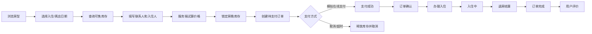

# 民宿预订与经营管理系统需求规格说明书

> 文档版本：2.0
>
> 文档状态：课程设计/毕业设计开发基线
>
> 适用对象：产品、后端、前端、数据库、测试、指导教师和验收人员
>
> 系统定位：基于 Spring Boot、Vue、MySQL 和 Redis 的民宿预订与经营管理系统

---

## 1. 编写目的

本文档将“房型管理、在线预订、订单管理、房客信息维护、入住统计和在线住宿经营管理”转化为可开发、可测试、可验收的系统需求。文档中的“必须”表示首期交付范围；“可选”表示在首期核心功能完成后再实现的扩展能力。

本文档同时作为：

- 数据库表和接口设计的依据；
- 用户端和管理端页面设计的依据；
- 单元测试、接口测试和验收测试的依据；
- 课程设计说明书中“需求分析、概要设计、详细设计和系统测试”章节的事实基线。

当前项目采用单体应用，先实现一间民宿或一个门店的完整业务闭环。代码结构预留多门店字段，但首期不要求复杂的多商户结算和跨门店运营。

---

## 2. 项目背景与建设目标

### 2.1 项目背景

传统民宿使用电话、即时通讯工具或表格管理房源，容易出现房态不准确、重复预订、入住人资料分散、订单查询困难和经营数据统计不及时等问题。本系统通过统一的用户端和管理端，将房型展示、库存查询、预订、入住、退房和经营统计纳入同一套业务流程。

### 2.2 总体目标

系统建成后应达到以下目标：

1. 管理员能够维护民宿、房型、实体房间、价格、图片和设施。
2. 用户能够按入住日期、离店日期和入住人数查询可预订房型。
3. 用户能够在线创建订单，查看订单状态，并完成模拟在线支付。
4. 前台人员能够处理人工订单、分配房间、办理入住、换房和退房。
5. 系统能够维护联系人、实际入住人和常用房客资料，并对身份证号码脱敏展示。
6. 管理人员能够查看订单量、入住率、收入、今日入住、今日离店和当前在住等统计数据。
7. 系统能够防止同一实体房间在同一日期被重复预订，并保留订单和操作记录。
8. 系统能够在 PC 浏览器和移动浏览器上完成主要业务操作。

### 2.3 预期成果

首期交付应包括：

- Spring Boot 后端项目；
- Vue 3 用户端项目；
- Vue 3 管理端项目；
- MySQL 建库脚本和初始化数据；
- REST API 接口文档；
- 单元测试、接口测试和核心流程测试；
- Docker Compose 开发部署文件；
- 用户操作说明和管理员操作说明。

---

## 3. 建设范围与边界

### 3.1 首期必须实现的范围

| 模块 | 必须实现的功能 |
|---|---|
| 账号与权限 | 用户注册、登录、退出；管理员登录；角色和菜单权限 |
| 民宿资料 | 民宿基本资料、联系方式、地址、入住规则、图片 |
| 房型管理 | 房型名称、描述、面积、床型、人数、基础价格、设施、图片、上下架 |
| 实体房间 | 房号、楼层、所属房型、运营状态、备注 |
| 房态与库存 | 按入住日期查询库存；预订锁定；维修/停用影响可售库存 |
| 用户预订 | 选择日期、房型、数量、入住人、联系人并创建订单 |
| 订单管理 | 订单列表、详情、支付、取消、确认、入住、退房、状态查询 |
| 房客资料 | 联系人资料、实际入住人资料、常用入住人、身份证脱敏 |
| 前台接待 | 人工下单、收款、分房、入住登记、换房、退房 |
| 统计分析 | 今日入住、今日离店、当前在住、订单量、收入、入住率、趋势 |
| 评价反馈 | 已完成订单评价；管理员查看、隐藏和回复 |
| 日志审计 | 登录、订单、支付、入住、退房和敏感资料访问日志 |

### 3.2 首期明确不实现的功能

以下内容不作为首期验收条件：真实微信/支付宝支付、OTA 渠道、电子发票、公安旅业接口、门锁控制、原生 App、小程序、多商户结算、会员积分、优惠券中心、智能推荐、动态定价和复杂财务对账。

支付功能只实现“模拟在线支付”和“管理端线下收款”。模拟支付不得接触真实资金，也不得保存真实支付密钥。

### 3.3 可选扩展

首期核心闭环完成后，可以增加餐饮点单、接送、加床、保洁任务、维修工单、通知中心、优惠券和多门店经营分析。这些功能必须以独立模块加入，不得影响核心订单、库存和入住流程。

当前 P1 已落地通知中心：用户可以查看订单、支付、入住、退房和评价回复消息，支持分页、未读数、单条已读和全部已读；消息由对应业务事务在状态变化后生成。

---

## 4. 用户角色与权限

### 4.1 角色定义

| 角色 | 说明 |
|---|---|
| 游客 | 浏览民宿和房型、查询价格与库存，不能创建订单 |
| 普通用户 | 管理本人资料、创建预订、支付、取消、查看订单和评价 |
| 前台员工 | 处理人工预订、收款、分房、入住、换房和退房 |
| 运营管理员 | 管理民宿、房型、房间、价格、评价、公告和经营数据 |
| 系统管理员 | 管理员工账号、角色、权限、系统参数和审计日志 |

### 4.2 权限编码

权限以字符串编码保存，后端接口必须校验权限，前端菜单过滤不能替代后端鉴权。

- `property:view`、`property:update`
- `room-type:list`、`room-type:create`、`room-type:update`、`room-type:publish`
- `room:list`、`room:create`、`room:update`、`room:status`
- `reservation:list`、`reservation:create`、`reservation:view`、`reservation:cancel`
- `reservation:assign-room`、`reservation:check-in`、`reservation:check-out`
- `payment:collect`、`payment:simulate`、`payment:refund`
- `guest:view`、`guest:update`、`guest:view-sensitive`
- `report:view`、`review:moderate`
- `system:user`、`system:role`、`system:audit`

### 4.3 数据权限

普通用户只能访问自己创建的订单和自己维护的房客资料。前台员工只能操作被授权门店的业务数据。运营管理员可以查看门店全部业务数据。完整身份证号码只允许具有 `guest:view-sensitive` 权限的员工在办理入住等必要场景查看，普通查询只返回脱敏值。

---

## 5. 业务术语与核心对象

| 术语 | 定义 |
|---|---|
| 民宿 | 对外经营的住宿场所，包含地址、联系方式和经营规则 |
| 房型 | 对外销售的住宿产品，例如大床房、家庭房 |
| 实体房间 | 实际可入住的房间，例如 301、302 |
| 房晚 | 一个实体房间在一个入住夜晚的库存单位，入住日计入，离店日不计入 |
| 预订订单 | 用户或前台为一组入住安排创建的业务单据 |
| 联系人 | 下单、支付和接收通知的主要联系人 |
| 入住人 | 实际入住的人员，可以与联系人不同 |
| 房态 | 实体房间当前的可用、预订、入住、清洁或维修状态 |
| 可售库存 | 指定日期内可被订单占用的房间数量 |
| 房账 | 一次入住期间的房费、附加费用、收款和退款记录 |

核心关系为：一个民宿包含多个房型，一个房型包含多个实体房间，一个订单包含一个或多个订单房间，一个订单房间关联一个或多个入住人。

---

## 6. 总体业务流程

### 6.1 用户在线预订流程



### 6.2 管理端经营流程

管理员先建立民宿、房型和实体房间，设置基础价格与房型状态；用户预订或前台人工创建订单后，系统锁定对应日期的库存；前台分配实体房并登记入住人，退房时完成费用结算，系统将房间置为待清洁或可用；经营看板从订单、支付和入住记录中计算统计指标。

### 6.3 异常流程

- 库存不足：订单创建失败，不产生半张订单，不扣款。
- 支付超时：订单自动取消，释放已锁定房晚。
- 用户取消：根据取消规则计算应退金额，模拟支付订单记录退款结果。
- 房间维修：不能影响已入住客人；对未来订单提示管理员重新分房或联系用户。
- 重复提交：使用幂等键返回首次操作结果，不重复创建订单或支付记录。
- 网络重试：接口返回明确的业务订单号和状态，客户端可以安全查询结果。

---

## 7. 功能需求

### 7.1 账号与登录

#### 7.1.1 用户注册

用户使用手机号或用户名注册，并设置密码。用户名和手机号必须唯一；密码至少 8 位，必须包含字母和数字。注册成功后可以登录并维护个人资料。

#### 7.1.2 登录与退出

登录接口返回访问令牌和有效期。用户退出后服务端使令牌失效或进入黑名单。连续登录失败应限制频率并记录安全日志。管理员登录使用独立的管理端入口，但与普通用户共用统一身份模型和权限校验机制。

#### 7.1.3 个人资料

用户可以维护昵称、头像、手机号和默认联系人。手机号修改必须重新验证。存在未完成订单时不允许直接删除账号；注销后订单和审计记录仍需保留脱敏数据。

### 7.2 民宿资料管理

运营管理员可以维护：

- 民宿名称、简介、地址、地图坐标和联系电话；
- 入住时间、离店时间、最晚入住时间；
- 取消政策、入住须知和注意事项；
- 民宿封面、轮播图和详情图片；
- 营业状态：营业、暂停营业、已关闭。

暂停营业只禁止新订单，不得自动取消已经确认的订单；管理员必须通过订单处理流程解决冲突。

### 7.3 房型管理

#### 7.3.1 房型字段

每个房型必须维护：

- 房型名称、编码和所属民宿；
- 面积、床型、楼层说明和最大入住人数；
- 基础价格、可入住人数、早餐说明；
- 房型描述、设施标签和图片；
- 取消规则、上下架状态和排序值。

#### 7.3.2 房型操作

管理员可以新增、编辑、上架、下架和查看房型。下架房型不能创建新订单，但已存在订单仍可查询和办理入住。修改基础价格不能修改历史订单，订单必须保存下单时的价格快照。

#### 7.3.3 实体房间管理

管理员可以维护房号、楼层、所属房型、备注和运营状态。实体房间状态包括：

- `AVAILABLE`：可用；
- `RESERVED`：存在未来预订；
- `OCCUPIED`：入住中；
- `DIRTY`：退房待清洁；
- `MAINTENANCE`：维修中；
- `DISABLED`：停用。

未来某日已被预订属于日期库存，不应简单覆盖当前实体房间状态。删除房间采用停用方式，禁止物理删除已有业务记录。

### 7.4 房源浏览与库存查询

用户端首页展示民宿信息、推荐房型、价格和评价。搜索条件包括入住日期、离店日期、入住人数和房间数量。系统必须校验：入住日早于离店日、入住日期不能早于当前业务日期、日期范围不能超过系统配置的最大预订天数。

搜索结果至少返回：房型名称、图片、床型、最大入住人数、可售数量、每晚价格、日期区间总价、取消说明和设施摘要。价格由服务端计算，不能信任前端传入的总价。

### 7.5 在线预订

#### 7.5.1 创建订单

用户填写：

- 入住日期和离店日期；
- 房型和房间数量；
- 联系人姓名、手机号；
- 每间房的主要入住人；
- 特殊要求和备注；
- 支付方式。

首期允许一个订单包含多个房型和多间房，但同一订单使用相同入住和离店日期。每个房间必须能关联主要入住人，同行人可以在入住前补录。

#### 7.5.2 创建订单事务

服务端必须在一个事务内执行：

1. 校验用户、房型、日期、人数和上下架状态；
2. 按“房型 × 房间数 × 房晚”重新计算价格；
3. 锁定可售房晚或执行等价的并发安全库存校验；
4. 写入订单、订单明细、入住人快照和价格快照；
5. 创建支付单和订单状态；
6. 提交事务后返回不可预测的订单号。

任一步骤失败都必须回滚库存和订单数据。并发创建订单时，同一实体房间同一天不能被两个有效订单占用。

#### 7.5.3 价格快照

订单必须保存下单时的房型名称、房型编码、基础价格、优惠金额、税费、总金额和取消政策。管理员后续修改房型资料或价格不得影响已创建订单。

### 7.6 模拟在线支付与线下收款

#### 7.6.1 模拟支付

用户在订单支付页选择“模拟在线支付”，系统生成带有效期的一次性支付单。测试页面提供成功、失败、取消和超时四种结果。支付成功后，订单从“待支付”变为“已确认”；支付失败或超时不能改变订单为已确认。

支付确认必须校验支付单号、订单号、金额、一次性令牌、有效期和当前支付状态。重复确认只返回第一次结果。

#### 7.6.2 管理端线下收款

前台可以登记现金、刷卡或其他线下收款方式。每笔收款包含金额、时间、操作人和备注。收款金额不得超过应收金额，撤销收款必须记录原因并写入审计日志。

### 7.7 订单管理

#### 7.7.1 用户端订单

用户可以按全部、待支付、已确认、入住中、已完成和已取消筛选本人订单，查看订单详情、房间明细、入住人、金额、支付记录和操作记录。待支付订单可以继续支付；符合取消规则的订单可以取消，页面必须在确认前展示预计扣费和退款金额。

#### 7.7.2 管理端订单

前台和管理员可以按订单号、联系人、手机号、房号、状态、入住日期和创建时间查询订单。管理端支持人工创建订单、修改未入住订单的联系人和入住人、分配房间、取消订单、办理入住和退房。

#### 7.7.3 订单状态

订单状态包括：

| 状态 | 含义 |
|---|---|
| `PENDING_PAYMENT` | 待支付 |
| `CONFIRMED` | 已确认，等待入住 |
| `PARTIALLY_CHECKED_IN` | 多房订单部分入住 |
| `CHECKED_IN` | 全部房间已入住 |
| `PARTIALLY_CHECKED_OUT` | 部分房间已退房 |
| `COMPLETED` | 全部退房并完成结算 |
| `CANCELLED` | 已取消 |
| `NO_SHOW` | 未按规则到店 |

状态只能按允许的业务路径变化，不能通过普通修改接口直接写入任意状态。

### 7.8 房客信息维护

#### 7.8.1 房客资料

房客资料包括姓名、性别、手机号、证件类型、证件号码、备注和历史入住次数。联系人和实际入住人必须分开保存，允许一个订单的联系人不是实际入住人。

#### 7.8.2 身份证信息

身份证号码属于敏感信息：

- 数据库不保存明文；
- 应用层使用 AES-256-GCM 加密；
- 使用不可逆摘要支持重复校验；
- 普通接口只返回例如“110**********1234”的脱敏值；
- 查看完整证件号必须有专门权限并记录审计日志；
- 日志、异常信息和接口响应禁止输出完整证件号。

#### 7.8.3 常用入住人

登录用户可以保存常用入住人，创建订单时选择并复制资料快照。订单快照不能因常用入住人后续修改而变化。

### 7.9 办理入住、换房和退房

#### 7.9.1 分房

前台只能将订单房间分配给所属房型匹配、日期可用且未维修/停用的实体房间。分房操作记录操作人和时间。

#### 7.9.2 办理入住

入住条件：订单已确认、当前日期符合入住规则、房间已分配、主要入住人资料完整、应收款和押金满足配置。入住后保存实际入住时间、操作人和房间状态。

#### 7.9.3 换房

入住中的订单允许换房。新房间必须属于兼容房型且在剩余日期可用。换房必须保留旧房间、新房间、时间、原因、费用差额和操作人记录。

#### 7.9.4 退房

退房时系统汇总房费、附加费用、已收款、退款和应退押金。退房成功后记录实际离店时间，房间变为待清洁或可用状态，订单在全部房间完成结算后变为已完成。

### 7.10 评价与反馈

已完成订单的用户可以提交一次评价，评分范围 1～5 分，可填写文字和上传不超过配置大小的图片。管理员可以隐藏违规评价但不能修改原文，民宿可以回复评价。评价只允许关联本人已完成订单。

### 7.11 入住统计与经营看板

管理端首页必须提供以下统计卡片：

- 今日入住订单数和房间数；
- 今日离店订单数和房间数；
- 当前在住订单数和房间数；
- 待处理订单数；
- 可售房数量、维修房数量和待清洁房数量；
- 指定日期范围订单数、实收金额和退款金额；
- 入住率、平均房价和可选的 RevPAR。

统计支持按日、月和自定义日期范围筛选，支持按房型汇总。图表至少包含订单量趋势、收入趋势和入住率趋势。收入按有效收款扣除退款、冲正和折扣计算，待收金额排除已作废附加费用。所有指标都必须显示统计时间范围，避免把“订单数”和“房间数”混为一谈。

---

## 8. 业务规则

### 8.1 库存规则

1. 入住日计入库存，离店日不计入库存。
2. 同一实体房间同一入住日期只能被一个有效订单占用。
3. 待支付订单可以临时锁定库存，锁定时间由系统参数控制，默认 15 分钟。
4. 订单取消、支付超时或创建失败后必须释放库存。
5. 维修和停用房间不能出现在未来日期的可售库存中。
6. 已入住订单不能被普通库存清理任务释放。

### 8.2 价格规则

订单总价 = 各房间各房晚价格之和 + 附加费用 - 优惠金额。所有价格以服务端计算为准。金额使用 Decimal 类型和人民币分为最小单位，不使用浮点数。

### 8.3 取消规则

首期支持统一取消政策：

- 入住前 24 小时以上取消：全额退还已支付金额；
- 入住前不足 24 小时取消：扣除首晚房费；
- 入住日后取消：由管理员按实际入住和退房规则处理。

取消规则必须在订单创建时保存快照，后续修改政策不影响历史订单。

### 8.4 分页与排序

列表接口默认按创建时间倒序，分页参数由后端限制最大页大小。查询条件为空时不得执行无边界全表扫描；统计接口应使用聚合查询并配套索引。

### 8.5 审计规则

登录、修改房型价格、修改房间状态、查看敏感证件信息、创建/取消订单、收款、退款、入住和退房都必须记录操作人、时间、来源 IP、业务对象和结果。

---

## 9. 数据库需求

数据库使用 MySQL 8.0，字符集为 `utf8mb4`，时间统一以 UTC 保存并在前端按系统时区展示，金额使用 `DECIMAL(12,2)`。

### 9.1 核心表

| 表名 | 用途 | 关键字段 |
|---|---|---|
| `sys_user` | 用户和员工 | id、username、phone、password_hash、status |
| `sys_role` | 角色 | id、code、name |
| `sys_permission` | 权限 | id、code、name |
| `sys_user_role` | 用户角色关系 | user_id、role_id |
| `sys_role_permission` | 角色权限关系 | role_id、permission_id |
| `property` | 民宿资料 | id、name、address、phone、status |
| `room_type` | 房型 | id、property_id、name、base_price、max_guests、status |
| `room_type_image` | 房型图片 | id、room_type_id、url、sort_no |
| `room` | 实体房间 | id、room_type_id、room_no、floor、status |
| `guest_profile` | 房客资料 | id、user_id、name、id_type、id_no_ciphertext、id_no_hash |
| `reservation` | 订单主表 | id、order_no、user_id、check_in、check_out、status、total_amount |
| `reservation_item` | 订单房型明细 | id、reservation_id、room_type_id、quantity、unit_price |
| `reservation_room` | 订单实体房间 | id、reservation_item_id、room_id、status |
| `reservation_guest` | 订单入住人快照 | id、reservation_room_id、name、id_no_ciphertext |
| `room_night_inventory` | 房晚库存 | id、room_id、stay_date、reservation_id、status |
| `payment` | 收款记录 | id、payment_no、reservation_id、amount、status、method |
| `refund` | 退款记录 | id、refund_no、payment_id、amount、status |
| `folio_charge` | 房账费用 | id、reservation_id、type、amount、description |
| `review` | 评价 | id、reservation_id、user_id、score、content、status |
| `audit_log` | 审计日志 | id、operator_id、action、resource_type、resource_id、result |

### 9.2 约束与索引

- `sys_user.username`、`sys_user.phone`、`reservation.order_no` 唯一；
- `room(property_id, room_no)` 唯一；
- `room_night_inventory(room_id, stay_date)` 唯一；
- 订单查询索引覆盖 `status`、`check_in`、`check_out`、`user_id`、`created_at`；
- 房型查询索引覆盖 `property_id`、`status`；
- 所有业务表包含创建时间、更新时间和逻辑删除标识；
- 业务订单、支付和审计记录禁止物理删除。

### 9.3 数据初始化

初始化脚本应创建：一个民宿、至少三个房型、每个房型两个实体房间、管理员账号、前台账号、普通测试用户和完整角色权限。初始化密码只能作为开发环境示例，生产环境必须修改。

---

## 10. 系统架构与技术要求

### 10.1 确定技术栈

| 层次 | 技术 |
|---|---|
| 后端 | Java 21、Spring Boot 3.x、Spring Web、Validation |
| ORM | MyBatis-Plus；复杂 SQL 使用明确的 Mapper 查询 |
| 权限 | Sa-Token 或 Spring Security，项目统一选定一种实现 |
| 数据库 | MySQL 8.0，业务数据唯一持久化来源 |
| 缓存与并发控制 | Redis 7.x，用于缓存、短时锁、限流和会话辅助 |
| 数据库迁移 | Flyway |
| 用户端 | Vue 3、TypeScript、Vite、Pinia |
| 管理端 | Vue 3、TypeScript、Vite、Pinia、Element Plus |
| 测试 | JUnit 5、MockMvc、Vitest、Playwright |
| 部署 | Docker Compose、Nginx |

### 10.2 模块结构

```text
homestay-platform/
├── backend/                 # Spring Boot 单体后端
│   ├── src/main/java/.../auth
│   ├── src/main/java/.../property
│   ├── src/main/java/.../reservation
│   ├── src/main/java/.../guest
│   ├── src/main/java/.../statistics
│   └── src/main/resources/db/migration
├── web-user/                # 用户端 Vue 应用
├── web-admin/               # 管理端 Vue 应用
├── deploy/                  # Docker Compose 和 Nginx
└── docs/                    # API 和测试说明
```

### 10.3 Redis 使用要求

Redis 作为 MySQL 的辅助组件，不保存不可恢复的唯一业务事实。系统必须能够在 Redis 暂时不可用时明确降级或拒绝需要并发保护的写操作，不能在 Redis 故障时静默产生重复预订。

首期 Redis 用途如下：

| 用途 | Key 示例 | 规则 |
|---|---|---|
| 房型查询缓存 | `homestay:room-type:{propertyId}:{dateHash}` | 只缓存展示和查询结果，房型或库存变化后主动删除；短 TTL |
| 登录会话/令牌辅助 | `homestay:session:{tokenId}` | 保存过期时间和用户标识，不保存密码；退出时删除或标记失效 |
| 支付和订单幂等 | `homestay:idempotency:{scope}:{key}` | 保存首次响应摘要和过期时间，禁止无限增长 |
| 短时库存锁 | `homestay:inventory-lock:{roomId}:{stayDate}` | 使用带过期时间的原子占位；最终占用必须写入 MySQL |
| 接口限流 | `homestay:rate:{route}:{subject}:{window}` | 使用原子计数和过期时间，超限返回明确错误码 |
| 统计热点数据 | `homestay:stats:{metric}:{range}` | 允许失效后重算，不得影响订单和入住操作 |

Redis Key 必须统一前缀、设置 TTL，并禁止使用无界集合存储用户输入。库存锁只能减少并发冲突，不能替代 MySQL 的唯一约束和事务校验。订单创建成功后，缓存删除失败不得回滚已提交订单，应通过重试或主动失效保证最终刷新。

推荐使用 Lettuce 客户端和 Spring Data Redis，连接超时、命令超时、最大连接数和序列化方式通过配置文件管理。对象序列化优先使用 JSON 或明确的字符串格式，禁止直接反序列化不可信 Java 对象。

### 10.4 后端分层

Controller 只负责参数接收和响应包装；Service 负责业务编排和事务；Domain/Entity 表示业务对象；Mapper 负责数据访问；DTO/VO 负责接口输入输出；敏感字段不得直接从 Entity 序列化到前端。

统一响应格式：

```json
{
  "code": "0",
  "message": "success",
  "data": {},
  "traceId": "..."
}
```

错误响应必须包含稳定的业务错误码，例如 `RESERVATION_STOCK_NOT_ENOUGH`、`ORDER_STATUS_INVALID` 和 `PAYMENT_EXPIRED`。

---

## 11. REST API 需求

所有接口使用 `/api/v1` 前缀，JSON 使用 UTF-8。写接口支持 `Idempotency-Key` 请求头。需要登录的接口使用 Bearer Token。

### 11.1 认证接口

| 方法 | 路径 | 说明 |
|---|---|---|
| POST | `/auth/register` | 用户注册 |
| POST | `/auth/login` | 用户登录 |
| POST | `/auth/logout` | 用户退出 |
| GET | `/auth/me` | 当前用户资料和权限 |
| PUT | `/users/me` | 修改本人资料 |

### 11.2 用户端房源接口

| 方法 | 路径 | 说明 |
|---|---|---|
| GET | `/properties` | 民宿列表 |
| GET | `/properties/{id}` | 民宿详情 |
| GET | `/room-types` | 按日期查询房型和库存 |
| GET | `/room-types/{id}` | 房型详情 |
| GET | `/room-types/{id}/availability` | 指定日期库存 |

### 11.3 订单与支付接口

| 方法 | 路径 | 说明 |
|---|---|---|
| POST | `/reservations/price-check` | 试算订单价格 |
| POST | `/reservations` | 创建订单 |
| GET | `/reservations` | 当前用户订单列表 |
| GET | `/reservations/{orderNo}` | 订单详情 |
| POST | `/reservations/{orderNo}/cancel` | 取消订单 |
| POST | `/reservations/{orderNo}/payments` | 创建支付单 |
| POST | `/payments/{paymentNo}/simulate` | 模拟支付确认 |
| GET | `/payments/{paymentNo}` | 查询支付状态 |

### 11.4 房客接口

| 方法 | 路径 | 说明 |
|---|---|---|
| GET | `/guests` | 当前用户的常用入住人 |
| POST | `/guests` | 新增常用入住人 |
| PUT | `/guests/{id}` | 修改常用入住人 |
| DELETE | `/guests/{id}` | 删除常用入住人 |

### 11.5 管理端接口

| 方法 | 路径 | 说明 |
|---|---|---|
| GET/PUT | `/admin/property` | 民宿资料 |
| GET/POST/PUT | `/admin/room-types` | 房型管理 |
| GET/POST/PUT | `/admin/rooms` | 实体房间管理 |
| GET | `/admin/reservations` | 订单查询 |
| POST | `/admin/reservations` | 人工创建订单 |
| POST | `/admin/reservations/{orderNo}/assign-room` | 分房 |
| POST | `/admin/reservations/{orderNo}/check-in` | 办理入住 |
| POST | `/admin/reservations/{orderNo}/change-room` | 换房 |
| POST | `/admin/reservations/{orderNo}/check-out` | 退房 |
| POST | `/admin/payments/collect` | 登记线下收款 |
| GET | `/admin/statistics/overview` | 看板汇总 |
| GET | `/admin/statistics/trends` | 趋势数据 |
| GET | `/admin/audit-logs` | 审计日志 |

---

## 12. 前端页面需求

### 12.1 用户端页面

| 路由 | 页面 | 主要内容 |
|---|---|---|
| `/` | 首页 | 民宿介绍、热门房型、搜索入口 |
| `/room-types` | 房型列表 | 日期、人数、房型和设施筛选 |
| `/room-types/:id` | 房型详情 | 图片、价格、设施、评价、预订入口 |
| `/booking` | 填写订单 | 联系人、入住人、日期、房间数量 |
| `/payment/:orderNo` | 支付页 | 金额、模拟支付选项和结果 |
| `/orders` | 我的订单 | 状态筛选和订单列表 |
| `/orders/:orderNo` | 订单详情 | 房间、住客、费用、支付、取消 |
| `/guests` | 常用入住人 | 新增、编辑、删除和脱敏展示 |
| `/profile` | 个人中心 | 个人资料和退出 |

### 12.2 管理端页面

| 路由 | 页面 | 主要内容 |
|---|---|---|
| `/dashboard` | 经营看板 | 今日数据、入住率、收入和趋势 |
| `/property` | 民宿设置 | 基本资料、规则和图片 |
| `/room-types` | 房型管理 | CRUD、价格、设施、上下架 |
| `/rooms` | 房间管理 | 房号、房态、维修/停用 |
| `/inventory` | 房态日历 | 按日期查看房间库存 |
| `/reservations` | 订单管理 | 查询、筛选、人工下单、状态操作 |
| `/reservations/:orderNo` | 订单详情 | 分房、入住、换房、退房、收款 |
| `/guests` | 房客管理 | 查询入住人和权限范围内的证件信息 |
| `/reviews` | 评价管理 | 审核、隐藏、回复 |
| `/users` | 用户管理 | 用户状态、角色和账号 |
| `/audit-logs` | 审计日志 | 按人员、动作和时间查询 |

### 12.3 页面通用要求

所有列表页面支持加载状态、空状态、错误提示、分页和条件重置。表单必须在前端做基本校验，后端必须再次校验。删除、取消、退房和隐藏评价等不可逆或有业务影响的操作必须二次确认。

---

## 13. 统计口径

### 13.1 订单量

指定日期范围内按订单创建时间统计成功创建的订单数量。取消订单是否计入必须由页面明确选择；默认统计全部创建订单，并单独展示已取消数量。

### 13.2 入住率

入住率 = 统计期间已售房晚数 ÷ 统计期间可售房晚数 × 100%。维修、停用房间不计入可售房晚分母；取消且释放的房晚不计入已售房晚。

### 13.3 平均房价

平均房价 = 住宿房费 ÷ 已售房晚数。附加服务费、押金和退款不计入房费。

### 13.4 收入

经营收入默认统计已确认收款的住宿费用和已完成的附加服务费用；押金不计入收入；退款在统计中作为负数扣减，并显示退款金额。

### 13.5 当前在住

当前在住是当前日期存在有效入住记录且尚未完成退房的订单房间数。不能以订单创建或支付状态代替实际入住状态。

---

## 14. 安全、隐私与可靠性

1. 密码只保存强哈希值，禁止明文和可逆加密。
2. 所有管理端接口必须进行身份、角色和资源权限校验。
3. 身份证号码加密保存、摘要去重、脱敏返回和访问审计。
4. 对登录、注册、支付确认和敏感信息接口进行频率限制。
5. 文件上传校验扩展名、MIME、大小和图片内容，文件名使用随机值。
6. 使用参数化查询，禁止拼接用户输入形成 SQL。
7. 生产环境通过 HTTPS 传输，密钥和数据库密码只从环境变量读取。
8. 核心写操作具备事务和幂等保护。
9. 后台异常返回统一错误码，不向前端泄露堆栈和数据库信息。
10. 每日备份数据库，备份文件不得放入 Git 仓库。

---

## 15. 测试需求

### 15.1 单元测试

至少覆盖：价格计算、取消费用、入住率计算、订单状态流转、身份证脱敏、权限判断和库存日期计算。

### 15.2 集成测试

使用测试 MySQL 和 Redis（推荐 Testcontainers）验证：

- 创建订单同时锁定多间房的多个房晚；
- 两个并发请求不能重复占用同一房晚；
- 支付成功后订单变为已确认；
- 支付超时后订单取消并释放库存；
- 部分入住和部分退房状态正确；
- 修改房型价格不影响历史订单快照。
- Redis 缓存失效后可以回源 MySQL，Redis 短时锁过期后不会留下永久占用。
- 重复使用相同幂等键不会创建重复订单或重复支付记录。

### 15.3 接口测试

验证所有必需接口的成功响应、参数错误、未登录、无权限、资源不存在和重复提交场景。接口测试不得只检查 HTTP 200，还要检查业务错误码和数据库状态。

### 15.4 端到端测试

至少完成以下流程：

1. 管理员登录并创建房型和实体房间；
2. 用户注册并查询指定日期房型；
3. 用户创建一单多房订单并模拟支付；
4. 前台分房并办理入住；
5. 前台登记收款并办理退房；
6. 用户查看已完成订单并评价；
7. 管理员查看入住统计和订单趋势。

---

## 16. 验收标准

| 编号 | 验收条件 |
|---|---|
| AC-01 | 用户可以注册、登录、退出并查看个人资料 |
| AC-02 | 管理员可以创建、编辑、上架和下架房型 |
| AC-03 | 管理员可以维护实体房间及房态 |
| AC-04 | 用户可以按日期和人数查询可售房型 |
| AC-05 | 用户可以创建一单多房订单 |
| AC-06 | 订单价格由服务端计算，前端篡改金额不能生效 |
| AC-07 | 同一房间同一日期不能被重复预订 |
| AC-08 | 模拟支付成功后订单变为已确认 |
| AC-09 | 支付超时会取消订单并释放库存 |
| AC-10 | 用户只能查看和取消本人订单 |
| AC-11 | 前台可以创建人工订单并登记线下收款 |
| AC-12 | 前台可以分房并办理入住 |
| AC-13 | 多房订单支持部分入住 |
| AC-14 | 入住中的订单可以换房并保留操作记录 |
| AC-15 | 前台可以退房并完成费用结算 |
| AC-16 | 订单保存联系人和入住人快照 |
| AC-17 | 普通接口不返回完整身份证号码 |
| AC-18 | 有权限的敏感信息访问会生成审计日志 |
| AC-19 | 用户可以提交已完成订单评价 |
| AC-20 | 管理员可以查看今日入住、今日离店和当前在住 |
| AC-21 | 管理员可以查看订单量、收入和入住率趋势 |
| AC-22 | 统计口径和时间范围在页面上明确显示 |
| AC-23 | 无权限用户不能访问管理端业务接口 |
| AC-24 | 核心异常场景返回明确业务错误码 |
| AC-25 | 核心流程通过单元、接口和端到端测试 |
| AC-26 | 使用 Docker Compose 可以启动后端、前端、MySQL 和 Redis 开发环境 |
| AC-27 | README、接口文档、数据库脚本和操作说明齐全 |

---

## 17. 开发顺序与完成定义

### 17.1 开发阶段

| 阶段 | 交付内容 |
|---|---|
| 1 | 工程初始化、数据库、登录和权限 |
| 2 | 民宿、房型、实体房间和图片管理 |
| 3 | 房态日历、库存查询和在线预订 |
| 4 | 模拟支付、订单查询、取消和人工订单 |
| 5 | 分房、入住、换房、退房和收款 |
| 6 | 房客资料、评价、审计日志和经营统计 |
| 7 | 测试、部署、文档和验收 |

### 17.2 完成定义

一个功能只有同时满足以下条件才算完成：

- 数据库结构、迁移脚本和初始化数据已提交；
- 后端接口、参数校验、权限和错误码已实现；
- 用户端或管理端页面已接入真实接口；
- 正常流程和至少一个异常流程有测试；
- 不产生未处理的敏感信息泄露；
- 文档、截图或接口示例已更新；
- 工作区无临时密码、真实密钥和调试数据。

---

## 18. 部署与运行要求

开发环境要求 Java 21、Node.js 20+、MySQL 8.0、Redis 7.x、Docker 和 Docker Compose。推荐使用 Docker Compose 启动 MySQL、Redis、后端和前端反向代理。

必须通过环境变量配置数据库地址、数据库用户名、数据库密码、令牌签名密钥和文件存储目录。`.env` 文件只能保存在本地或部署平台，不得提交到仓库。

启动后应能完成：

1. 打开用户端首页；
2. 打开管理端登录页；
3. 使用初始化管理员登录；
4. 查询初始化房型；
5. 创建测试订单并完成模拟支付；
6. 查看管理端统计数据；
7. 重启 Redis 后确认缓存可回源，且库存和订单数据仍以 MySQL 为准。

---

## 19. 与截图需求的对应关系

截图提出的“采用 Spring Boot + Vue、使用 MySQL，实现房型管理、在线预订、订单管理、房客信息维护、入住统计和在线完成民宿预订经营管理”，在本文档中的对应章节为：

- Spring Boot、Vue、MySQL、Redis：第 10 章；
- 房型管理：第 7.3 节；
- 在线预订：第 7.4～7.6 节；
- 订单管理：第 7.7 节；
- 房客信息维护：第 7.8 节；
- 入住和退房：第 7.9 节；
- 入住统计：第 7.11 节和第 13 章；
- 在线住宿经营闭环：第 6 章、第 16 章验收标准。

本需求文档将“设计目标”和“已实现功能”严格区分。当前文档是开发基线；只有完成代码、测试和第 16 章验收条件后，才能宣称系统实现了截图中的完整需求。
